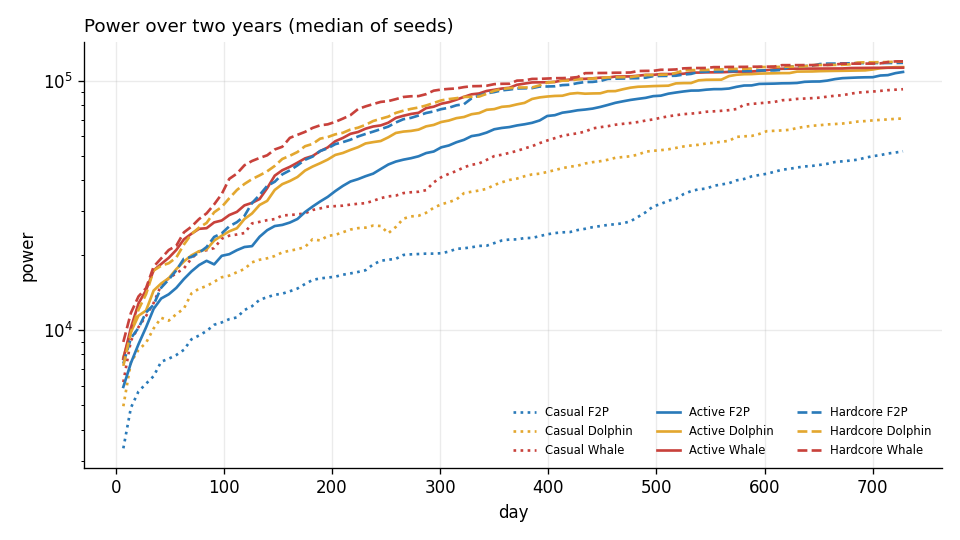
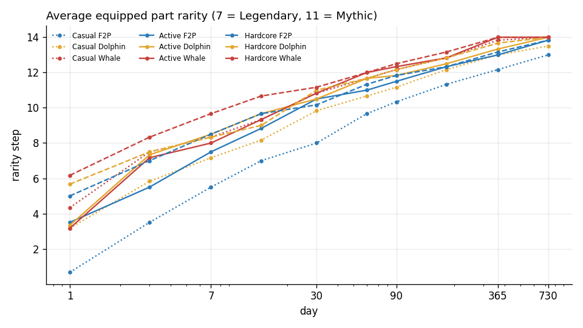
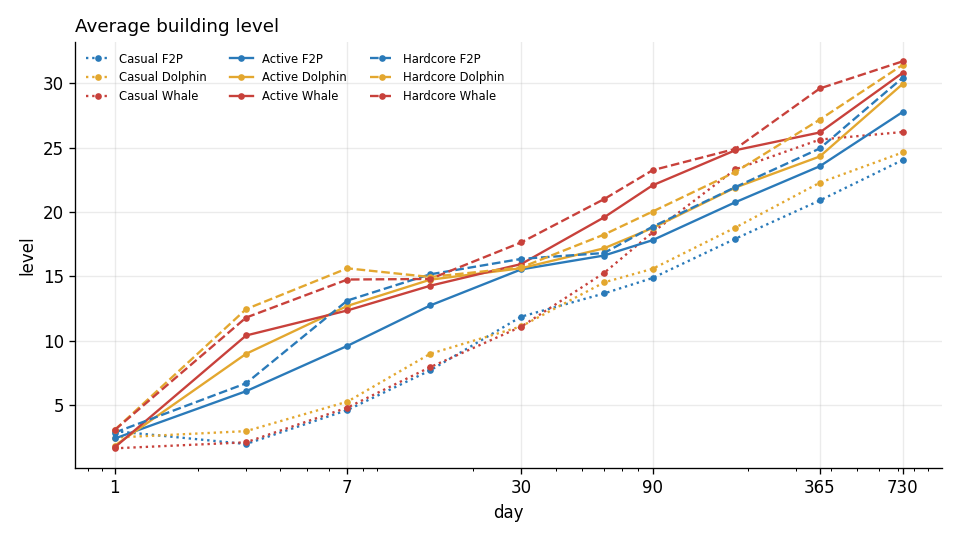
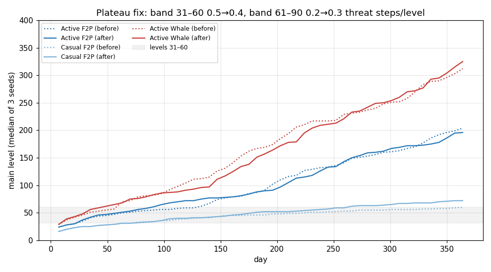
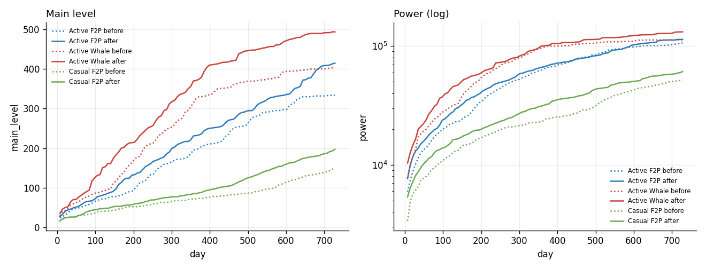
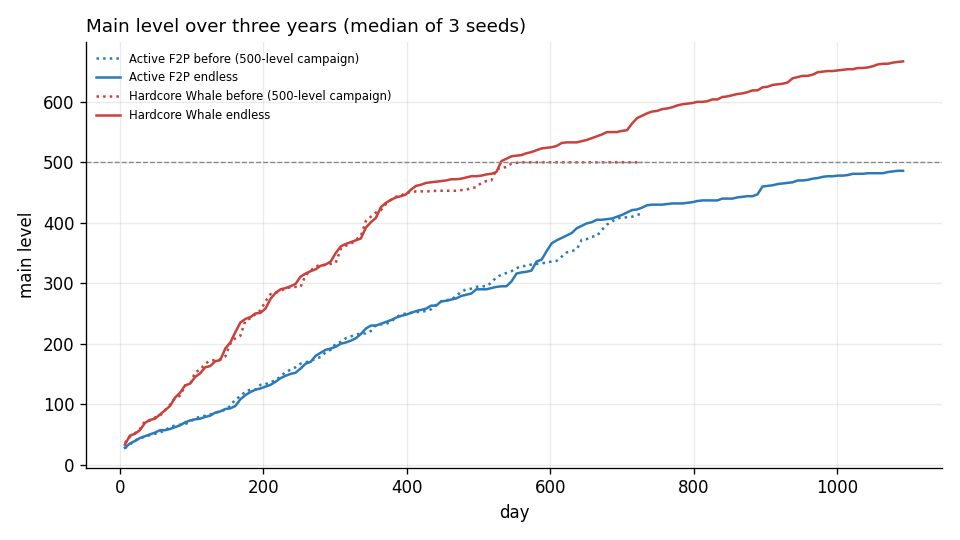
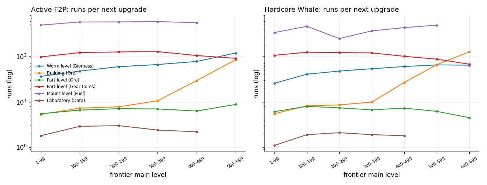

# Rogue Stars — meta-progression simulation and balance pass

Generated with `tools/RogueStars.Sim` (bots playing the real rules engine for 730 days) plus hand-written findings.
Raw medians per checkpoint: `docs/balance/data/<time>_<spend>.csv` (after the balance pass) and `*_before.csv`
(content before this pass), weekly series `data/weekly*.csv`, full generated analysis `data/analysis*.md`.

## How the simulator works

```
DOTNET_CLI_TELEMETRY_OPTOUT=1 arch -arm64 ~/.dotnet/dotnet run --project tools/RogueStars.Sim -c Release -- \
    [--days 730] [--seeds 3] [--profiles Active:F2P,Hardcore:Whale] [--label before] [--out docs/balance] [--quiet] \
    [--variant no_lab_stats,no_part_skills,old_biomass,part_skills_x0.5]   # content experiments (tools/RogueStars.Sim/Variants.cs)
<venv>/bin/python tools/RogueStars.Sim/charts.py docs/balance [before_label] [after_label]   # matplotlib, local venv
```
All 9 profiles × 3 seeds × 730 days take ~9 minutes on 10 cores (one simulation per core, deterministic by seed).
The guard test `tools/RogueStars.Sim.Tests/ProgressionGuardTests` (60 days, Active F2P + Active Whale, ~10 s) runs with
the solution tests.

- **Real rules only.** Every state change is a `GameEngine.Execute` command (≈0.1–1.7 M per account over two years).
  Server-only commands are issued the way the server issues them: `PurchaseStart`/`PurchaseComplete` with dev receipts
  (offline mode), `ArenaFightResult`/`ArenaWeekEnd`, `InvasionRecordDamage`/`LiveOpsApplyOutcome`, `GuildSetMembership`.
  Battles outside runs use `BattleSimulator.PlayerVsSnapshot` / `PlayerVsBoss` like the server. Runs are played with
  `RunAutoStep` (drafts, events, shops on auto) plus the bot's revive, double-reward-ad and Burrow descend/cash-out
  choices.
- **Time profiles** (sessions at fixed UTC hours ±15 min): Casual 2 × 7.5 min, Active 4 × 15 min, Hardcore 7 × 26 min.
  Actions cost session time: session 0.5 min, daily claims 0.5, city round 0.75, upgrade round 0.5, a pull 0.15,
  an ad 0.5 (No Ads: 2 s), an arena fight 0.75, an invasion attempt 1.0. **A run costs what happened in it**:
  20 s + 2.5 s per roll + 3 s per draft/event/shop popup + 1.6 s per battle round ÷ battle speed (×2 free,
  ×3 with the monthly pass) — typically 2–3.5 minutes. Runs stop when the session ends or stamina (incl. allowed
  refills: daily free, ads up to cap, Diamonds 1/2/5 per day for F2P/Dolphin/Whale) runs out. Casual players are
  time-limited, Hardcore players stamina-limited.
- **Spend profiles:** F2P; Dolphin (No Ads, Daily Diamonds, monthly pass, season pass); Whale (the same + $300/month,
  spread evenly over the month: starter packs, funds, flash/gift/rolling offers, then the biggest Diamond packs; Diamonds
  go to refills, timer rushes, weekly token packs and 10-pulls on the Star Knight / mount banners).
- **Policy (greedy but reasonable):** frontier run when promising (after a loss: retry once power grew 1% or the next
  day), otherwise farm the best reward-per-stamina level with a ≥ 70% recent win rate; Overcharged and Dark Side
  frontiers; Burrow with keys; claims of login/quests/chests/mail/passes/funds/daily products; ads up to the caps
  (Casual 50%); cheapest-first spending of Biomass (talents, worm levels) and Ore (equipped part levels) with the city
  allowed up to half the balance per upgrade (the cheapest one may take all) and the lab's next research kept in
  reserve; quick-merge + manual Mythic merges, best-part equip, runes (merge, socket), Forge, S/SS; hero/mount unlocks,
  stars, levels, best equipped; alien squad by combat power, workers by work power, star/level ups; breeding the best
  squad alien until its genes are good (plus two cheap breeds a week for the quest); gacha: daily token packs
  (cheapest Diamonds per pull), all tokens, ad pulls, Diamond 10-pulls above a reserve.
- **Other players** are modelled in two places only. Arena: a *snapshot ladder* — the player's own loadout scaled by a
  league factor (0.86 + 0.055 × league, ±15%), weekly rank from points against a N(1000, 120) group. Invasions: the
  invader is the content boss at 2.5× the player's frontier threat with an unlimited HP pool; the group is 19 synthetic
  members (0–6 attempts, log-normal scores around the player's), repelled at ≥ 40 group attempts. So whales do not
  dominate arena leagues in the sim.

## Headline numbers (after the balance pass and the plateau fix, median of 3 seeds)

> Numbers in this section and in "Generated tables" are from before the parts/lab/cores redesign (they equal the
> `*_pre_redesign` data); the endless campaign (section "Endless campaign") changes year one by < 3% on average. Current content: see "Parts/lab/cores redesign" below and `data/analysis_redesign.md`; the
> charts in `charts/` are regenerated from the redesign run.

| Profile | main level d7 / d30 / d90 / d365 / d730 | Power d7 / d30 / d90 / d365 / d730 | spent by d730 |
|---|---|---|---|
| Casual F2P | 16 / 25 / 34 / 72 / 149 | 3.4k / 6.2k / 10.4k / 23.5k / 51.7k | $0 |
| Casual Dolphin | 23 / 29 / 46 / 99 / 178 | 5.0k / 9.2k / 15.1k / 41.5k / 74.0k | $409 |
| Casual Whale | 22 / 33 / 54 / 108 / 166 | 6.2k / 11.9k / 21.7k / 55.0k / 95.7k | $7 687 |
| Active F2P | 24 / 39 / 61 / 196 / 335 | 5.9k / 10.8k / 18.6k / 64.3k / 106.4k | $0 |
| Active Dolphin | 28 / 45 / 73 / 240 / 371 | 7.8k / 13.3k / 23.6k / 76.4k / 108.4k | $409 |
| Active Whale | 29 / 50 / 83 / 326 / 403 | 7.7k / 15.0k / 26.4k / 98.2k / 112.7k | $7 695 |
| Hardcore F2P | 29 / 47 / 75 / 258 / 369 | 7.4k / 12.6k / 22.9k / 86.8k / 117.5k | $0 |
| Hardcore Dolphin | 29 / 49 / 85 / 281 / 400 | 7.2k / 14.9k / 28.9k / 90.7k / 118.3k | $409 |
| Hardcore Whale | 33 / 56 / 91 / 334 / 410 | 9.1k / 16.9k / 32.5k / 102.8k / 122.2k | $7 695 |

Long-haul targets: hero 10★ — Active F2P ≈ day 700, Casual F2P 9★ at day 730, whales ≈ day 365. Mount 5★ for F2P by
day ~180, full awakening (5) not reached by any F2P in two years (awakening 4). Mythics per pull type per week: Active
F2P ≈ 1.5, Casual F2P ≈ 0.7 (hidden pity at 50 pulls). Mythic+3 on all six parts: Active F2P just before day 730 (13.8 average), whales between day 365 and 730. Main campaign: 500 levels; Active F2P is at ~196 after a year and ~335 after two, Active whales reach ~400 around
day 615. Campaign main-level medians are noisy between neighbouring profiles (e.g. Casual Whale vs Casual Dolphin:
whales spend Casual session minutes on pulls); Power is the steadier measure.







## Before → after

Before = content at the start of this pass (30 main levels, no mount duplicates, no awaken cores, 2 lab levels …),
same bot. Every profile hit the end of the campaign (level 30) by day 7–90, the Dark Side (gated at 40) was
unreachable, mounts never left 1★, S/SS awakening never happened, the lab was done by day ~20, and power went flat
(55–69% of 4-week windows < 1% growth) in year two for Active profiles.

| Profile | main level d30 / d90 / d365 / d730 before → after | Power d365 / d730 before → after |
|---|---|---|
| Casual F2P | 26 / 30 / 30 / 30 → 25 / 34 / 60 / 153 | 34.1k / 52.7k → 23.1k / 52.5k |
| Active F2P | 30 / 30 / 30 / 30 → 37 / 55 / 205 / 335 | 65.7k / 81.5k → 65.5k / 109.5k |
| Active Whale | 30 / 30 / 30 / 30 → 47 / 82 / 313 / 400 | 79.6k / 89.1k → 95.1k / 113.1k |
| Hardcore F2P | 30 / 30 / 30 / 30 → 44 / 58 / 275 / 377 | 74.3k / 92.8k → 92.6k / 118.5k |
| Hardcore Whale | 30 / 30 / 30 / 30 → 51 / 96 / 351 / 418 | 85.0k / 102.6k → 97.6k / 120.0k |

Flags over all 9 profiles (same analysis code): walls 256 → 196, caps/never-progressed 49 → 14, hoarding/no-income
43 → 31; Active F2P flat year-two power 57% → 12% of 4-week windows. Early power is a bit lower after the pass (parts
no longer reach Mythic in month one); late power is higher because systems keep progressing. Whale mythic pulls drop
(1 735 → 1 206 by day 730) because a quarter of Blueprint Signal outcomes are now mount copies.


## Findings

**Walls** (longest stretch without a meaningful upgrade per system; limits 7 / 14 / 21 / 35 days for the windows
1–60 / 61–180 / 181–365 / 366–730; full table at the end):
- Campaign: smooth after the pass (Active F2P ≤ 11 days without a new level until day 365, ≤ 18 in year two). The
  soft plateau at main levels ~50–60 for Active F2P (days ~60–140) is gone after the plateau fix (see below).
  Before: a hard cap at level 30.
- Heroes: one star every 2–5 weeks in year one, 6–10 weeks towards 10★ — the intended long haul (1 100 shards for the
  last star). Whales are done at ~day 365 and then pull only for collection bonuses (128-day gap in year two).
- Mounts (new source): steady to 5★ in ~3–6 months; awakening steps 5–9 weeks apart in year two.
- Laboratory (60 research levels now): 2–7 week gaps while level 3/4 research runs in the single slot; done by day
  ~130–180 for Active, ~730 for Casual. Before: done in 2–3 weeks.
- Part levels: 6–7 week gaps in days 61–180 for F2P (Ore goes to buildings first); Gear Cores are no longer the limit.
- Breeding (kept children): stops once squad genes reach the target — a natural cap of the gene range, not Grain.

**Early caps / stalls:** Dark Side has only 10 levels (cleared by day ~180–365 for Active/Hardcore); Laboratory maxed
at day ~130–180 (Active); whales max heroes (≈ d365), mount stars (≈ d30), parts Mythic+3 (d365–730) and aliens (9.8★ average by d730).

**Hoarding:** Gear Cores and Advancement Plates still pile up late (265–430 days of income banked at day 730, < 20%
spent) once every equipped part is level- and cap-maxed; Part Awaken Cores after all six parts are SS (sink
exhausted); whales/dolphins bank Hero XP (equipped hero maxed) and Fuel (mount level cap). Casual players bank
stamina from quest/login rewards (they are time-limited, not stamina-limited).

**Starvation:** Biomass and Ore are spent fully every day by every profile (≈ 100% of income) — they are the real
pacing currencies (worm levels, buildings, part levels). F2P Diamonds sit at the reserve because the daily token packs
absorb them.

**F2P vs whale:** whale/F2P power ratio (Active) 1.30 at day 7, 1.47 at day 90, 1.45 at day 365, then **1.03 at day
730**; campaign 1.21 → 1.49 → 1.53 → 1.19. Whales are clearly faster in year one, but F2P catches up in year two
because the whale has maxed most collections — pulls stop adding power (collection bonuses only). Hardcore F2P is
close to a whale at day 365 (ratio 1.05): stamina, not money, limits progress at 3 h/day.

**Power curve:** decelerating and never flat in year one for anyone (weekly growth 21–35% in days 1–60, 3–6% in 61–180,
1.4–3% in 181–365); in year two 0.3–1.6% per week with 12–47% flat 4-week windows for Active/Hardcore profiles (whales
45–47%).

## Tuning applied (content numbers, not logic)

| Area | Before | After | Why |
|---|---|---|---|
| Main campaign | 3 portals, 30 levels, threat = level − 1 | 50 portals / 500 levels from 4 biome templates (`ContentDb.Campaign`); threat steps per level 1 (levels 1–30), then 0.4, 0.3, 0.12, 0.12, 0.1, 0.08, 0.07, 0.06 per 30 levels (plateau fix: was 0.5, 0.2) (fractions as enemy HP/ATK %), void biome −25%, stamina 5 + portal (max 10), rewards × (portal + 1) | Dark Side (gate 40) unreachable, campaign over in a week; one curve step per level outpaces power after year one; void-biome spikes made the campaign stair-stepped |
| Dark Side | threat 30 + 2·(i−1) | starts 5 steps below its gate level (`DarkSideFromLevel` = 40) | follows the new curve |
| Mounts | no duplicate source | ~25% of Blueprint Signal outcomes are mount copies (1/1/2/5/10 by tier, first copy unlocks), "Lancer Shipyard" mount banner (15 copies); awakening shards 1 620 → 1 040, cores 1 300 → 2 500; Mount Cores from Burrow floors 6+ and Dark Side clears | mounts never left 1★; Fuel hoarded |
| Part awakening | no Part Awaken Core source; S/SS 20/60 | Burrow floor 10, Dark Side clears and Dark Side loot; S/SS 40/150 | S/SS impossible |
| Part ladder | Mythic+1/+2/+3: 1 / 2 / 1+1 Mythic | 3 / 4 / 1 same + 5 Mythic of the same kind | all parts near Mythic+3 by ~day 365 for F2P |
| Part levels | Gear Cores 1 + (L−20)/8 from 20; cap raises 5…80 plates; Forge 40/120 cores | 2·(L−9)^1.25 from level 10; 60…1 600 plates; Forge 400/1 200 cores; Gear Works 6 → 2/h, run Gear Cores halved; Plate Foundry 1.5 → 0.5/h; Burrow plate loot halved | 1.2 M Gear Cores / 216 k plates banked unused |
| Laboratory | 2 levels per line (24 total) | 5 levels (60 total), up to 40 k Biomass / 20 k Ore and 48 h | done in ~2 weeks |
| Buildings | cost ×1.35 and time ×1.22 per level, max level 8 + 2/★ | ×1.2 and ×1.12, max level 12 + 2/★ | city stalled for months (cost growth far above income) |
| Aliens | level Grain base 20…100, ×1.1 per level | 80…400, ×1.065 | level wall at ~day 90 (×1.1), then Grain hoarding |
| Fuel Refinery | 25/h | 15/h | Fuel hoarding |

## Plateau fix (levels 31–60)

The simulator showed Active F2P nearly stalled at main levels ~55–60 from day ~50 to day ~140: the 31–60 band added
0.5 threat steps per level right after the original three portals, while power grows only 3–6% per week in that
period. Applying 0.4 alone removes the stall but lowers the threat of every later level by 3 steps, which made year one
too fast (Active F2P main level 205 → 254 at day 365, Active Whale 313 → 374). The fix therefore moves the difficulty
instead of removing it: **band 31–60 0.5 → 0.4 and band 61–90 0.2 → 0.3** threat steps per level
(`CampaignDef.LateSlopes`), so the threat of level 90 and everything after it is unchanged.

| Profile (3 seeds, 730 days) | level 50 → 60 | levels gained d50–d140 | longest 5-level gap (d28–250) | main level d90 / d180 / d365 | hero best ★ d90 / d180 / d365 / d730 |
|---|---|---|---|---|---|
| Active F2P before | day 63 → 133 (70 days) | 45 → 67 (+22) | 42 days | 54 / 85 / 205 | 5 / 6 / 8 / 10 |
| Active F2P after | day 63 → 91 (28 days) | 47 → 77 (+30) | 35 days | 61 / 86 / 196 | 4 / 6 / 8 / 10 |
| Casual F2P before | day 224 → 364 | 28 → 41 | 84 days | 34 / 46 / 60 | 4 / 5 / 6 / 8 |
| Casual F2P after | day 182 → 266 | 28 → 42 | 56 days | 34 / 51 / 72 | 4 / 5 / 7 / 9 |
| Active Whale before | day 35 → 63 | 55 → 115 | 28 days | 82 / 166 / 313 | 6 / 8 / 10 / 10 |
| Active Whale after | day 35 → 49 | 62 → 97 | 21 days | 83 / 148 / 326 | 6 / 8 / 10 / 10 |

Hero 10★ timings stay where they were (whales at day ~365, Active F2P between day 365 and 730), power at day 365
moves by −2…+3%, and the campaign at day 365 stays within −4…+4% for Active profiles. Casual F2P gains ~12 levels in
year one because it lives in the 31–60 band all year. Longest stretch without a new level (median): Casual F2P 20 / 25 → 16 / 18
days in days 61–180 / 181–365, Active Whale 15 → 5 in days 181–365, Active F2P 11 days in days 61–180 either way
(now slow-but-steady instead of a two-month crawl) and 27 → 18 in year two. Variants tried (365 days, same three profiles): 0.4 / 0.2 → Active F2P d365 254 (too
fast); 0.4 / 0.25 → 227; 0.4 / 0.3 → 200 (chosen).

Side effect (not hidden by the guard): the first **part-level wall** moves into the first 60 days. Active F2P seeds
1–3 went 7 / 13 / 10 days without a part level before day 60 before the fix and 17 / 19 / 13 after (from day ~31–43).
Gear Cores and plates bank up meanwhile and Ore flows into buildings, so the limit is the level cap of the current
rarity: with the frontier moving faster through levels 31–50 the bot farms fewer runs, gets fewer part drops and its
Mythic merges land 1–2 weeks later (part rarity average at day 60 11.3 → 11.0, equal again by day 180). The guard's
PartLevels limit moved 9 → 20 days with this note; the content-side fix is recommendation 8.



## Parts/lab/cores redesign

Content change (2026-11, product-owner approved): 14-step part ladder to Mythic SS+2 with fodder points and five skills
per part (`docs/design/parts.md`), one-time awakening for 50 Awaken Cores, cores only from the arena shop (new PvP
currency Arena Medals), high-tier invasions and deep Burrow floors, a 38-node laboratory tree mixing stat and skill
nodes, paid in Data (Dark Side, now 150 procedural levels), the Research Annex (second slot), Biomass mainly from portal
runs (daily surge: first 3 won portal runs ×4) and Ore for Mythic+ merges. Simulated with the same bot (9 profiles ×
3 seeds × 730 days); *before* = content just before the redesign (`data/*_pre_redesign.csv`, `data/redesign_pre_redesign.md`),
*after* = `data/*_redesign.csv`, `data/redesign_redesign.md`, `data/analysis_redesign.md`. Bot additions: merges focus
on the best equipped part, copies still needed by equipped parts are kept, everything else is fodder; it awakens the best
Mythic+ part, buys cores in the arena shop, staffs the Annex, farms the Dark Side for Data while research waits for it
(≤ 15% / 35% / 40% of a day's run stamina for Casual / Active / Hardcore).

### Campaign and power, before → after (median)

| Profile | main level d180 / d365 / d730 | power d365 / d730 |
|---|---|---|
| Casual F2P | 51 / 72 / 149 → 56 / 85 / 198 | 23.5k / 51.7k → 31.7k / 61.2k |
| Casual Dolphin | 65 / 99 / 178 → 74 / 114 / 202 | 41.5k / 74k → 44.7k / 72.3k |
| Casual Whale | 77 / 108 / 166 → 87 / 122 / 183 | 55k / 95.7k → 56.8k / 92.4k |
| Active F2P | 86 / 196 / 335 → 124 / 232 / 416 | 64.3k / 106.4k → 66.8k / 114.6k |
| Active Dolphin | 130 / 240 / 371 → 157 / 264 / 459 | 76.4k / 108.4k → 75.6k / 114.8k |
| Active Whale | 148 / 326 / 403 → 203 / 372 / 494 | 98.2k / 112.7k → 100.7k / 131.7k |
| Hardcore F2P | 131 / 258 / 369 → 172 / 311 / 500 | 86.8k / 117.5k → 90.6k / 141.1k |
| Hardcore Dolphin | 164 / 281 / 400 → 191 / 332 / 500 | 90.7k / 118.3k → 94.2k / 138.4k |
| Hardcore Whale | 194 / 334 / 410 → 240 / 423 / 500 | 102.8k / 122.2k → 112.9k / 148.2k |

Power at day 365 is within −1…+35% (≈ +3% for Active profiles), but the campaign moves 10–27% faster in year one:
part and lab skills (status chains, AoE, last stands) win more battles than the stat-based power score shows. In year two
the long-haul systems keep adding power (whales no longer flatten: power d365→d730 +31% vs +15% before), and **every
Hardcore profile reaches the end of the 500-level campaign around day 650–730** (Active Whale 494). See recommendations.



### Parts: one item up the exponential road (first day the best owned part reaches a rarity, median)

| Profile | Mythic | Mythic S | Mythic SS | Mythic SS+2 | before: Mythic / Mythic+3 (old top) |
|---|---|---|---|---|---|
| Casual F2P | 5 | 250 | – | – | 5 / 300 |
| Casual Dolphin | 2 | 140 | 693 | – | 2 / 170 |
| Casual Whale | 1 | 65 | 330 | – | 1 / 67 |
| Active F2P | 2 | 95 | 502 | – | 2 / 103 |
| Active Dolphin | 2 | 76 | 396 | – | 2 / 104 |
| Active Whale | 2 | 49 | 267 | – | 2 / 55 |
| Hardcore F2P | 2 | 66 | 337 | – | 1 / 88 |
| Hardcore Dolphin | 1 | 54 | 281 | – | 1 / 58 |
| Hardcore Whale | 1 | 43 | 217 | 603 | 1 / 61 |

(– = not within 730 days.) Mythic S costs ~51 Legendary-equivalents, Mythic SS ~284, Mythic SS+2 ~825: each skill
rung takes 3–5× the time of the previous one. Only the Hardcore Whale reaches SS+2 (day 603); every F2P profile needs
years (Active F2P is at SS on day 502). Before, the old top (Mythic+3) was reached in 2–10 months by everyone.

**Surplus:** quick merge turns everything below Legendary into Legendary fodder (3 → 1, any def/kind), so spare
parts below Legendary stay at 2–5 (before 38–50) and **nothing is dismantled any more** (before 2 300–26 100 parts per
account were dismantled). Spare Legendary+ parts at day 730: 40–169, mostly own-def copies kept for the coming S/SS
steps (before 128–975, a growing pile). Parts merged by day 730: Active F2P 4 495 (before 581), Hardcore Whale 13 100
(before 1 088).

### Awaken Cores and awakening

| Profile | cores / week d90–365 | d365–730 (arena shop / invasions / Burrow) | first awakening (day) |
|---|---|---|---|
| Casual F2P | 0.61 | 0.59 (0.56 / 0.02 / 0.02) | 582 |
| Casual Dolphin | 0.66 | 0.69 (0.52 / 0.06 / 0.12) | 519 |
| Casual Whale | 0.69 | 0.59 (0.44 / 0.08 / 0.08) | 551 |
| Active F2P | 1.15 | 1.17 (0.82 / 0.04 / 0.31) | 295 |
| Active Dolphin | 1.22 | 1.11 (0.82 / 0.04 / 0.25) | 295 |
| Active Whale | 1.20 | 1.11 (0.81 / 0.02 / 0.29) | 261 |
| Hardcore F2P | 2.04 | 1.98 (1.52 / 0.08 / 0.38) | 174 |
| Hardcore Dolphin | 2.11 | 2.15 (1.63 / 0.08 / 0.44) | 162 |
| Hardcore Whale | 2.06 | 1.94 (1.52 / 0.06 / 0.36) | 162 |

Before: ~15.6 cores per week from Burrow floor 10 alone for every Active/Hardcore profile (first S awakening on day
20–30). After: an active F2P player gets ~1.2 per week (target 1–2) and awakens a first part after ~10 months; money
does not buy cores (the arena shop limit and medal income are the same for whales). Casual players (2 arena fights a
day) get ~0.6 per week. Cores pile up between awakenings by design (the analysis flags "hoarding" while players save
for 50).

### Laboratory

Size (content, `LabTuningDef`; test `Tree_CannotBeFinishedInYearOne_EvenWithPerfectPlayAndTheAnnex`): 38 nodes, 187
research levels beyond the 3 default ones, the k-th research takes 1.5 h × 1.0355^k (1.5 h … 986 h), **28 727 nominal
hours** and **94 786 Data** in total.

| Perfect play (all 3 ads at the start of every timer = ×0.614, daily free speed-up 0.5 h) | nominal hours per year | tree |
|---|---|---|
| one slot, no Laboratory building boon | 14 561 | 1.97 years |
| one slot, strongest Laboratory boon (+26.9%: level 32, 10★) | 18 486 | 1.55 years |
| plus Research Annex from day 1 (second slot, ×2 timer) | 27 540 | 1.04 years |

So no player can finish the tree in year one with timers and ads alone, even with a second slot from day 1 and a maxed
Laboratory building (≈ 96% at best). Diamonds can finish timers (0.2 Diamonds per minute); a whale that rushes every lab
timer would need ~5 000 Diamonds per day — the simulated whales rush when they can afford it and reach 91% of levels /
55% of research hours at day 365.

| Profile | levels % / hours % at d30 | d90 | d180 | d365 | d730 |
|---|---|---|---|---|---|
| Casual F2P | 19 / 0.3 | 35 / 1.2 | 48 / 3.0 | 61 / 7.4 | 78 / 23 |
| Active F2P | 21 / 0.4 | 39 / 1.6 | 54 / 4.7 | 72 / 15.6 | 95 / 73 |
| Active Whale | 25 / 0.6 | 45 / 2.5 | 66 / 10.6 | 91 / 53 | 100 / 100 |
| Hardcore F2P | 23 / 0.5 | 42 / 1.9 | 60 / 6.9 | 81 / 27 | 100 / 100 |
| Hardcore Whale | 26 / 0.6 | 47 / 2.8 | 67 / 11.4 | 91 / 55 | 100 / 100 |

(Other profiles in `data/redesign_redesign.md`.) Before, the 60-level lab was done by day 130–180 (Active) and every
profile but Casual F2P had it at 100% by day 365. Now nobody finishes in year one; Active/Hardcore players finish in
year two, Active F2P is at 95% of levels / 73% of hours at day 730, casual players are at 23% of hours. The tree is
levels-front-loaded (cheap early researches) and hours-back-loaded (the last 20 levels hold half the hours).

**Data by source (per day, median):**

| Profile | d0–90 Dark Side / chests | d90–365 | d365–730 |
|---|---|---|---|
| Casual F2P | 0 / 34 | 4 / 34 | 17 / 34 |
| Active F2P | 9 / 34 | 40 / 34 | 154 / 35 |
| Active Whale | 29 / 34 | 181 / 35 | 287 / 34 |
| Hardcore F2P | 17 / 34 | 86 / 35 | 323 / 34 |
| Hardcore Whale | 34 / 34 | 235 / 35 | 211 / 34 |

The chests carry the lab until the Dark Side opens (main level 40); from day ~90 the Dark Side is the main Data source
for Active and Hardcore players (54–90% of Data). Casual players rarely farm the Dark Side (short sessions go to the
campaign) and research mostly on the daily trickle.

### Biomass by source (per day, median)

| Profile | window | runs (portal + Burrow) | city | quests/claims | runs' share |
|---|---|---|---|---|---|
| Casual F2P | d90–365 | 3.4k (before 0.5k) | 8.2k (before 15.6k) | 9.1k | 16% (before 2%) |
| Active F2P | d90–365 | 40.5k (before 8.0k) | 19.1k (before 38.2k) | 9.3k | 59% (before 15%) |
| Active F2P | d365–730 | 69.0k (before 11.0k) | 31.3k (before 62.1k) | 9.7k | 63% (before 14%) |
| Hardcore F2P | d365–730 | 107.6k (before 21.5k) | 55.7k (before 110.1k) | 9.7k | 62% (before 15%) |
| Active Whale | d365–730 | 74.7k (before 10.8k) | 37.2k (before 76.9k) | 9.7k | 61% (before 11%) |

Portal runs are now the main Biomass source for every Active and Hardcore profile (≈ 50–68% of all Biomass); the city
stays a meaningful second source (≈ 25–35%). 15-minute players still live on the city and the daily chests (the first three won
runs of a day are only 1–2 runs for them). Sinks are unchanged except the laboratory (no Biomass/Ore any more); Biomass
and Ore are still spent fully every day.

### Smoothness (year one and beyond)

Wall flags (stretches without any upgrade beyond 7 / 14 / 21 / 35 days per window, all systems, 9 profiles) 202 → 139,
early caps 18 → 6 (only Breeding, which stops once genes are good, and one HeroLevels), flat-power flags 5 → 2. The
longest campaign gap in year one is 20 days (Casual F2P, days 181–365; before 18); no system gets a new year-one wall.
Parts now upgrade every few days in every window (max gap 0–2 days, before up to 23); part levels have one long gap in
year two for Active/Hardcore profiles (44–62 days at the level cap of the current rarity while saving for the next
merge). Laboratory gaps are 3–20 days until the tree is done. New hoarding flags: Data after the tree is finished
(whales, Hardcore, day 600+), Awaken Cores while saving for 50.

### Tuning decisions made during the pass

- Part stat multipliers top out at ×11 (SS+2; Mythic SS ×9.8 ≈ the old Mythic+3) and part-skill amounts are scaled ×0.25
  (awakened ×0.3): with the first numbers (×16.5 top, full skills) Hardcore Whales finished the campaign by day 365.
- Laboratory stat nodes give +1% per level for HP/ATK/DEF/alien/mount power and +1…2 points for chance stats; research
  costs Data only (decided: no Biomass/Ore), 14·h^0.75 Data so early research is Data-gated and late research timer-gated.
- Mythic+ merges cost Ore (1.5k ×1.5 per step) — the lab no longer sinks Ore; steeper Ore (×2) stalled merges and piled
  up Legendaries.
- Below Mythic any def/kind merges (no copies), so surplus is never dead; the Replicator (10 LE + 5k Ore → a Legendary
  copy for a Mythic+ part) is the safety valve for S/SS copies (rarely needed by the bot once spare copies count as fodder).
- Biomass: run completion (120 + 30·level) × portal scale and loot 45–90 × scale (1.5× before), the daily surge (first 3
  won portal runs ×4) and city farms 0.5×.

## Endless campaign

Content change (2026-11, product-owner approved): the main campaign and the Dark Side never end. Portals past the 50
named ones are generated from their index on the same threat curve (0.06 steps per level forever), with per-run
currencies growing as threat^0.7, a one-time milestone chest every 10 levels and a portal-completion bonus every 50, run
item drops shifting up in rarity past level 500 (capped at Legendary), feats on every level, and the progress of levels
far behind the frontier folded into a compact archive. Formulas and the reward table at levels 100 … 2000:
`docs/design/economy-model.md` ("Endless campaign rewards"). *Before* = content just before this change
(`data/*_pre_endless.csv`, `data/analysis_pre_endless.md`), *after* = `data/*_endless.csv`, `data/endless_endless.md`
(9 profiles × 3 seeds × 730 days) and `data/*_endless_1095.csv`, `data/endless_endless_1095.md` (Active F2P and
Hardcore Whale, 3 seeds × 1 095 days). Bot change: the frontier is always `main_level_max + 1` (no campaign end), Dark
Side frontier and farming from the endless sequence.

### Campaign and power, before → after (median)

| Profile | main level d90 / d180 / d365 / d730 | power d365 / d730 | milestone chests d365 / d730 |
|---|---|---|---|
| Casual F2P | 43 / 56 / 85 / 198 → 42 / 58 / 88 / 201 | 31.7k / 61.2k → 32.4k / 61.7k | 8 / 20 |
| Casual Dolphin | 52 / 74 / 114 / 202 → 55 / 78 / 128 / 210 | 44.7k / 72.3k → 46.1k / 73.6k | 12 / 21 |
| Casual Whale | 56 / 87 / 122 / 183 → 55 / 86 / 121 / 176 | 56.8k / 92.4k → 57.3k / 92.6k | 12 / 17 |
| Active F2P | 66 / 124 / 232 / 416 → 70 / 118 / 234 / 425 | 66.8k / 114.6k → 68.9k / 114.0k | 23 / 42 |
| Active Dolphin | 79 / 157 / 264 / 459 → 83 / 159 / 280 / 475 | 75.6k / 114.8k → 79.6k / 121.8k | 28 / 47 |
| Active Whale | 114 / 203 / 372 / 494 → 103 / 201 / 360 / 507 | 100.7k / 131.7k → 95.8k / 131.0k | 36 / 50 |
| Hardcore F2P | 84 / 172 / 311 / 500 → 88 / 171 / 299 / 511 | 90.6k / 141.1k → 87.0k / 134.0k | 29 / 51 |
| Hardcore Dolphin | 111 / 191 / 332 / 500 → 109 / 190 / 357 / 553 | 94.2k / 138.4k → 97.4k / 140.3k | 35 / 55 |
| Hardcore Whale | 128 / 240 / 423 / 500 → 131 / 243 / 426 / 580 | 112.9k / 148.2k → 108.2k / 146.2k | 42 / 58 |

**Year one is not faster:** main level at day 365 is +2.6% on average over the 9 profiles (−4 … +12%; the +12% is
Casual Dolphin, within its seed noise), power at day 365 +0.6% (−5 … +5%), days 90/180 within ±1%. The only year-one
content change is the milestone chests (≈ 2% more Diamonds and pull tokens for an active player) and the late glacier
offset from level 401. **Nobody hits a campaign end:** every Hardcore profile and the Active Whale pass level 500 in
year two (before: capped at 500 from day ~560–700) and keep going.

### Past two years (Active F2P and Hardcore Whale, 1 095 days)

| Profile | main level d365 | d730 | d910 | d1095 | power d730 → d1095 |
|---|---|---|---|---|---|
| Active F2P | 234 | 425 | 462 | 486 | 114k → 137k |
| Hardcore Whale | 426 | 580 | 628 | 668 | 146k → 173k |

| Days per 50 levels (median) | 300→350 | 350→400 | 400→450 | 450→500 | 500→550 | 550→600 | 600→650 |
|---|---|---|---|---|---|---|---|
| Active F2P | 41 | 61 | 235 | – | – | – | – |
| Hardcore Whale | 54 | 48 | 52 | 125 | 135 | 127 | 208 |

| Longest stretch without a new main level (days) | d1–180 | d181–365 | d366–545 | d546–730 | d731–910 | d911–1095 |
|---|---|---|---|---|---|---|
| Active F2P | 15 | 9 | 22 | 13 | 25 | 23 |
| Hardcore Whale | 6 | 14 | 14 | 17 | 17 | 20 |



Past level ~450 the campaign is power-gated: heroes, mounts, aliens, the laboratory and most buildings are maxed by
year three (Hardcore Whale: hero 10★, mount awakening 5, aliens 10★, lab 100%, buildings 31.9 of 32), so power grows
only ~19% a year (worm levels, the part ladder towards SS+2) and the frontier advances ~0.3 levels per day (whale) /
~0.15 (Active F2P) — slow, but without a hard stop: the longest stretch without a new level stays ≤ 25 days in years two
and three (analysis wall limit for year two: 35 days). The pace barely depends on α (Hardcore Whale level 650 at day
1 095 for α = 0.4, 0.55 and 0.7: `data/endless_alpha_*.md`).

**New wall found and fixed — glacier portals.** Without the late family offset the endless campaign was stair-stepped:
every long stall (≥ 3 weeks in the weekly medians) sat in a glacier-family portal (levels 411–419, 453, 530, 573,
610–614, 651: the Frost Leviathan freezes the whole side every 5 rounds and shields up, the roster counters), and the
longest stretch without a new level reached 38–44 days in year three (`data/endless_lateglacier_0.md`). Glacier portals
from portal 41 on now get −20% enemy HP/ATK (`CampaignDef.LateFamilyStrengthPct`, like the void family's −25% everywhere):
−10% halved the stalls (`data/endless_lateglacier_-10.md`), −20% removed every ≥ 3-week stall and moved Hardcore Whale
day 1 095 from 650 to 668, Active F2P from 479 to 486, while Hardcore Whale's day 365 stays at the pre-endless value
(426 vs 423).

### Income vs costs: runs per upgrade by frontier level

Cost of the cheapest next upgrade of each sink at the player's actual state ÷ that currency's reward of one won
frontier run (completion + 2 loot rolls, expected value, no surge/ads; Data: Dark Side frontier); median over the days
spent in each band, 3 seeds, 1 095 days.

| Hardcore Whale | 200–299 | 300–399 | 400–499 | 500–599 | 600–699 |
|---|---|---|---|---|---|
| Worm level (Biomass) | 48 | 54 | 60 | 65 | 64 |
| Part level (Ore) | 7.4 | 6.7 | 7.3 | 6.2 | 4.5 |
| Part level (Gear Cores) | 122 | 120 | 101 | 87 | 68 |
| Mount level (Fuel) | 248 | 366 | 432 | 489 | maxed |
| Laboratory (Data) | 2.1 | 1.9 | 1.8 | tree done | tree done |
| Building (Ore) | 8.6 | 9.9 | 27 | 66 | 126 |

| Active F2P | 100–199 | 200–299 | 300–399 | 400–499 |
|---|---|---|---|---|
| Worm level (Biomass) | 48 | 60 | 67 | 78 |
| Part level (Ore) | 6.6 | 7.1 | 7.0 | 6.3 |
| Part level (Gear Cores) | 122 | 126 | 128 | 105 |
| Mount level (Fuel) | 575 | 577 | 586 | 556 |
| Laboratory (Data) | 2.9 | 3.0 | 2.4 | 2.2 |
| Building (Ore) | 7.3 | 7.8 | 10.6 | 29 |

The ratios stay flat across level 500 (worm 60 → 65 → 64 runs per level for the whale; part levels a little cheaper in
runs, mount levels until maxed, research ~2 Dark Side clears until the tree is done). With α = 0.4 the worm ratio would
have jumped to 87 / 98 and with 0.55 to 79 (economy-model.md). Buildings are the exception at every α: their cheapest
remaining upgrade climbs from ~10 to 126 runs of Ore because the city reaches its level caps (×1.2 per level) — the sink
runs out rather than the income falling behind; see recommendation 9. Active F2P only crosses level 500 at the very end
of year three (one seed), so its 500+ band is not shown.



### Memory and state size

Content: the 50 named portals (500 levels) and Dark Side levels 1–150 stay materialized; later ones are generated on
first access into a bounded cache (600 levels, regenerated identically). State: at day 1 095 an account holds ~215
per-level records (the last 100 main and 100 Dark Side levels plus the Burrow) and a 400–650-byte archive for everything
older (one character per level, nothing for a fully completed prefix), instead of one record per level played.

## Run length (~30-roll runs, GDD §3.3)

Playtest: runs ended after 6–10 rolls (the worm reached the boss gate of a 25–46-tile board long before the roll limit),
with ~1 draft per run — no build ever formed. Now the board is a circuit (the gate leads back to the first tile), the
boss's awakening meter is the clock (3.6 points per roll, boss tiles ±10, some event choices; the boss comes when it is
full, hard limit 45 rolls) and the run XP curve is 4 + 1 per level. Ordinary tiles pay in-run resources only; account
loot comes from completion (3 loot rolls, was 2) and at most 3 risky opportunities per run.

`dotnet run --project tools/RogueStars.Sim -c Release -- --run-length --days 365 --seeds 2` (Active F2P + Hardcore
Whale, every run recorded; "boss" = runs that reached the boss; the bot takes default choices, i.e. never the risky
account-loot options):

| Band | dice | rolls/run before → after (boss reached) | drafts/run before → after | won before → after |
|---|---|---|---|---|
| main 1–3 | 1 | 7.8 → 33.7 | 0.9 → 9.6 | 100% → 100% |
| main 4–10 | 1 | 9.8 → 29.1 | 1.4 → 8.7 | 99% → 98% |
| main 4–10 | 2 | 5.8 → 30.3 | 0.6 → 8.8 | 94% → 84% |
| main 11–30 | 1 | 10.1 → 29.7 | 1.4 → 8.5 | 91% → 79% |
| main 11–30 | 2 | 6.3 → 30.0 | 0.7 → 9.1 | 90% → 87% |
| main 31–60 | 1 | 10.2 → 30.6 | 1.2 → 7.6 | 50% → 37% |
| main 31–60 | 2 | 6.8 → 31.4 | 0.7 → 8.7 | 41% → 51% |
| main 61–150 | 1 | 11.1 → 32.5 | 1.2 → 7.5 | 26% → 22% |
| main 61–150 | 2 | 7.3 → 33.3 | 0.7 → 8.6 | 29% → 33% |
| main 151–400 | 1 | 11.0 → 34.2 | 1.2 → 8.0 | 25% → 23% |
| main 151–400 | 2 | 7.3 → 34.1 | 0.8 → 8.7 | 34% → 31% |
| Dark Side | 2 | 6.0 → 33.2 | 0.6 → 8.6 | 24% → 21% |

(Win rates past level 30 are frontier pushes: the bot retries a level until it wins.) Late bands run a little longer
than 30 because the bot's own Stasis Beacon (5–18% slower meter) and drafted Calm Mind stretch them — the intended
"skills shift it". Without any skill the rules test `RunLengthTests` measures 29.5–31.8 rolls on average for main levels
1, 3, 8 (two dice), 25, 100, 500 and Dark Side 10 (27–33 required), 8–10 drafts (8–12 required), and a 20% slower meter
adds ~8 rolls. A run takes ~2.5 minutes of session time instead of ~1, so time-limited players play fewer runs (~30% fewer
runs) — the third completion loot roll and the bigger build per run keep the campaign pace:

| Main level reached (seed 1–2) | before | after |
|---|---|---|
| Active F2P, day 60 (guard band 40–75) | 58 | 54 |
| Active Whale, day 60 (guard band 50–100) | 79 | 83 |
| Active F2P, day 365 | 198 / 200 | 241 / 217 |
| Hardcore Whale, day 365 | 432 / 402 | 411 / 402 |

**Account loot per run** (rewards that outlive the run, found during it): before, ordinary Cache tiles and events paid
0.2–0.9 items per run for the default-choice bot (uncapped, no risk attached). After: ordinary tiles pay none; account-loot
opportunities (guarded Treasure Pods, Abandoned Cache, Gravity Well, Wild Beast, Rift Echo, Black Market) average 0.8–1.1
per run and never exceed 3 (sim and `RunLengthTests`: 1.14 per run, max 3); a player who always takes the risk finds 1.6
items per run on average, the default-choice bot none (its income is the completion rolls). Per-run currencies at the
frontier (completion + 3 rolls, docs/design/economy-model.md table): Biomass/Ore +6%, Fuel/Gear Cores +50% (they only come
from loot rolls); per day roughly unchanged because of fewer runs. The Burrow now always dives 10 short floors (6 rolls
each, 60 rolls per run as before); its per-floor completion rewards are unchanged.

Early levels: `EarlyLevelBalanceTests` still holds (levels 1–3 lost ≤ 2 times in 60 new players, 4–6 ≤ 30) — the longer
runs give the first runs 8+ drafts, board fights are −15% (`RunTuning.BoardEnemyPct`) and every won fight heals 15% (was
8%), the fully awake boss is +15% (was +30%) since the meter now always fills.

**Guard test changes:** all existing bands unchanged (day 7/30/60 levels, walls, ratios, long-haul checks still pass).
New: `Runs_LastAbout30Rolls_WithABuildAndFewAccountLootOffers` — runs that reach the boss average 27–35 rolls (wider than
the rules test's 27–33 because the bot's Stasis Beacon / Calm Mind are allowed to stretch them), 8–12 drafts, at most 3
account-loot opportunities in any run and 0.5–2 on average.

## Remaining recommendations

0. ~~(Redesign) Campaign end for Hardcore profiles~~: done — the campaign is endless (see "Endless campaign"). Still
   open: a late Data sink (e.g. lab prestige) for players who finish the tree; Data per Dark Side clear keeps growing
   (threat^0.7) with nothing to buy once the tree is done.

1. **Late-game ceilings for spenders** (largest gap): whales cap heroes, parts, mount stars and aliens in 12–18 months
   and their power flattens (whale/F2P ratio 1.03 at day 730). Add ceiling content on a schedule (new heroes, mounts,
   blueprints, alien species through the banner rotation), a star tier beyond 10★ / awakening beyond 5, or stronger
   collection bonuses per duplicate, so pulls keep converting into power for years.
2. ~~Dark Side~~: done (procedural, endless since the endless campaign).
3. **Laboratory:** a second research slot from a building boon or more lines; it is done by month 5 for Active players.
4. **Gear Cores / plates / Part Awaken Cores:** after parts are maxed they have no sink — add a late sink (rune rerolls,
   set bonuses, part transmute) or taper their income at max.
5. ~~Campaign band 31–60~~: done (see "Plateau fix" above). The slowest campaign stretch for Active F2P is now levels
   77–81 around days 140–170 (≈ 1 level per week); watch it if the 61–90 band is retuned.
6. **Casual stamina:** quest/login stamina rewards pile up unused for 15-minute players (16 k banked); consider turning
   overflow stamina into run-reward boosts.
7. Arena and invasion outcomes use synthetic opponents; once live, replace the snapshot ladder with real snapshot
   distributions per league to measure whale pressure in PvP.
8. **Part drops at the portal 4–6 frontier:** raise part drop rarity/quantity of main levels 31–60 a little (or add a
   part token to their first-clear rewards) so merges keep pace with the faster campaign and the day 30–60 part-level
   wall shrinks back below ~10 days.
9. **(Endless) Late city sink:** buildings reach their level caps in year two/three, so the cheapest remaining upgrade
   costs 66–126 frontier runs of Ore past level 500 while every other sink stays flat. Add building tiers beyond the
   star cap (or an Ore sink such as part transmutes) before players live in the endless levels; and ceiling content
   (recommendation 1) is what speeds up the power-gated year-three pace (~0.15–0.3 levels per day).

## Guard test

`ProgressionGuardTests` (Active F2P and Active Whale, seed 1, 60 days): main level bands at day 7/30/60 (F2P 18–32 /
32–55 / 40–75, whale 20–40 / 40–75 / 50–100), no wall longer than 7–28 days per system in the first 60 days (part levels 20, see the plateau fix), whale/F2P
power ratio 1.15–2.6 at days 30 and 60, F2P not maxed early (hero ≤ 6★, mount ≤ 5★ and not awakened — was ≤ 4★ before the
endless campaign's milestone chests, which tip seed 1 over 5★ just before day 60, parts below Mythic S on average,
lab incomplete and < 5% of its research hours), no awakening for anyone in 60 days (whale < 50 cores), no below-Legendary
part pile (≤ 12 spare), 5–16 mythics per pull type in 60 days, run length (27–35 rolls to the boss, 8–12 drafts, ≤ 3
account-loot opportunities per run, see "Run length") and determinism by seed. (Redesign: bands unchanged, the
part/lab/core checks are new.) Move a band only after re-running the
simulator and updating this report.

## Generated tables (after the balance pass and the plateau fix)

**Worm level** (median)

| Profile | d1 | d7 | d30 | d90 | d180 | d365 | d730 |
|---|---|---|---|---|---|---|---|
| Casual F2P | 3 | 14 | 29 | 51 | 67 | 87 | 123 |
| Casual Dolphin | 3 | 19 | 30 | 47 | 57 | 84 | 123 |
| Casual Whale | 5 | 19 | 29 | 45 | 63 | 96 | 135 |
| Active F2P | 14 | 31 | 44 | 64 | 79 | 117 | 155 |
| Active Dolphin | 16 | 27 | 45 | 62 | 88 | 127 | 155 |
| Active Whale | 15 | 27 | 43 | 61 | 95 | 139 | 162 |
| Hardcore F2P | 24 | 35 | 51 | 73 | 102 | 142 | 178 |
| Hardcore Dolphin | 25 | 28 | 47 | 68 | 107 | 142 | 180 |
| Hardcore Whale | 27 | 27 | 45 | 73 | 115 | 150 | 180 |

**Best hero stars** (median)

| Profile | d1 | d7 | d30 | d90 | d180 | d365 | d730 |
|---|---|---|---|---|---|---|---|
| Casual F2P | 0 | 1 | 3 | 4 | 5 | 7 | 9 |
| Casual Dolphin | 0 | 1 | 3 | 5 | 6 | 8 | 10 |
| Casual Whale | 0 | 2 | 3 | 6 | 8 | 10 | 10 |
| Active F2P | 1 | 1 | 2 | 4 | 6 | 8 | 10 |
| Active Dolphin | 1 | 2 | 3 | 5 | 7 | 9 | 10 |
| Active Whale | 1 | 2 | 4 | 6 | 8 | 10 | 10 |
| Hardcore F2P | 1 | 2 | 3 | 5 | 7 | 9 | 10 |
| Hardcore Dolphin | 1 | 1 | 3 | 5 | 7 | 9 | 10 |
| Hardcore Whale | 1 | 2 | 4 | 6 | 8 | 10 | 10 |

**Star Knight (whale target) stars** (median)

| Profile | d1 | d7 | d30 | d90 | d180 | d365 | d730 |
|---|---|---|---|---|---|---|---|
| Casual F2P | 0 | 1 | 3 | 4 | 5 | 7 | 9 |
| Casual Dolphin | 0 | 1 | 3 | 5 | 6 | 8 | 10 |
| Casual Whale | 0 | 2 | 3 | 5 | 7 | 10 | 10 |
| Active F2P | 1 | 1 | 2 | 4 | 6 | 8 | 10 |
| Active Dolphin | 1 | 1 | 3 | 4 | 7 | 8 | 10 |
| Active Whale | 1 | 1 | 4 | 5 | 7 | 10 | 10 |
| Hardcore F2P | 1 | 2 | 3 | 5 | 7 | 9 | 10 |
| Hardcore Dolphin | 1 | 1 | 3 | 5 | 7 | 9 | 10 |
| Hardcore Whale | 1 | 1 | 3 | 6 | 8 | 10 | 10 |

**Best mount stars** (median)

| Profile | d1 | d7 | d30 | d90 | d180 | d365 | d730 |
|---|---|---|---|---|---|---|---|
| Casual F2P | 0 | 2 | 3 | 4 | 5 | 5 | 5 |
| Casual Dolphin | 0 | 2 | 2 | 4 | 5 | 5 | 5 |
| Casual Whale | 0 | 3 | 5 | 5 | 5 | 5 | 5 |
| Active F2P | 1 | 2 | 3 | 4 | 5 | 5 | 5 |
| Active Dolphin | 1 | 3 | 3 | 5 | 5 | 5 | 5 |
| Active Whale | 1 | 3 | 5 | 5 | 5 | 5 | 5 |
| Hardcore F2P | 1 | 2 | 3 | 4 | 5 | 5 | 5 |
| Hardcore Dolphin | 2 | 2 | 3 | 5 | 5 | 5 | 5 |
| Hardcore Whale | 2 | 2 | 5 | 5 | 5 | 5 | 5 |

**Avg equipped part rarity (0 Common … 7 Legendary … 11 Mythic … 14 Mythic+3)** (median)

| Profile | d1 | d7 | d30 | d90 | d180 | d365 | d730 |
|---|---|---|---|---|---|---|---|
| Casual F2P | 0.67 | 5.5 | 8 | 10.33 | 11.33 | 12.17 | 13 |
| Casual Dolphin | 3.17 | 7.17 | 9.83 | 11.17 | 12.17 | 13 | 13.5 |
| Casual Whale | 4.33 | 8.33 | 10.83 | 12.17 | 12.83 | 13.83 | 14 |
| Active F2P | 3.5 | 7.5 | 10.5 | 11.5 | 12.33 | 13 | 13.83 |
| Active Dolphin | 3.33 | 8.5 | 10.5 | 11.83 | 12.5 | 13.33 | 14 |
| Active Whale | 3.17 | 8 | 10.83 | 12.33 | 12.83 | 14 | 14 |
| Hardcore F2P | 5 | 8.5 | 10.17 | 11.83 | 12.33 | 13.17 | 13.83 |
| Hardcore Dolphin | 5.67 | 8.33 | 11 | 12.17 | 12.83 | 13.67 | 14 |
| Hardcore Whale | 6.17 | 9.67 | 11.17 | 12.5 | 13.17 | 14 | 14 |

**Avg building level** (median)

| Profile | d1 | d7 | d30 | d90 | d180 | d365 | d730 |
|---|---|---|---|---|---|---|---|
| Casual F2P | 3 | 4.64 | 11.88 | 14.88 | 17.93 | 20.9 | 24.03 |
| Casual Dolphin | 2.5 | 5.29 | 11.13 | 15.59 | 18.79 | 22.28 | 24.62 |
| Casual Whale | 1.67 | 4.83 | 11.11 | 18.41 | 23.31 | 25.62 | 26.21 |
| Active F2P | 2.43 | 9.62 | 15.55 | 17.82 | 20.76 | 23.55 | 27.76 |
| Active Dolphin | 1.88 | 12.71 | 15.64 | 18.76 | 21.9 | 24.31 | 29.93 |
| Active Whale | 1.75 | 12.36 | 15.96 | 22.07 | 24.79 | 26.17 | 30.79 |
| Hardcore F2P | 2.89 | 13.13 | 16.36 | 18.86 | 21.93 | 24.93 | 30.41 |
| Hardcore Dolphin | 3.1 | 15.63 | 15.7 | 20.03 | 23.1 | 27.17 | 31.41 |
| Hardcore Whale | 3.1 | 14.76 | 17.64 | 23.24 | 24.9 | 29.59 | 31.69 |

**Avg alien stars** (median)

| Profile | d1 | d7 | d30 | d90 | d180 | d365 | d730 |
|---|---|---|---|---|---|---|---|
| Casual F2P | 0 | 1.5 | 2.25 | 3.31 | 4.56 | 6.44 | 8.25 |
| Casual Dolphin | 0 | 1.85 | 2.94 | 4.69 | 6.13 | 7.94 | 9.25 |
| Casual Whale | 0 | 2 | 3.81 | 5.88 | 7.5 | 9.06 | 9.81 |
| Active F2P | 1.14 | 1.92 | 2.6 | 4.31 | 6.13 | 8.06 | 9.38 |
| Active Dolphin | 1 | 2.07 | 3.13 | 5.25 | 6.94 | 8.63 | 9.63 |
| Active Whale | 1.2 | 2.07 | 3.81 | 6.13 | 7.94 | 9.25 | 9.81 |
| Hardcore F2P | 1.29 | 1.79 | 2.69 | 4.94 | 6.88 | 8.5 | 9.75 |
| Hardcore Dolphin | 1.13 | 2.14 | 3.38 | 5.56 | 7.56 | 8.94 | 9.81 |
| Hardcore Whale | 1.14 | 2.2 | 4 | 6.5 | 8.13 | 9.5 | 10 |

**Mythic pulls (all types)** (median)

| Profile | d1 | d7 | d30 | d90 | d180 | d365 | d730 |
|---|---|---|---|---|---|---|---|
| Casual F2P | 0 | 1 | 7 | 21 | 45 | 102 | 237 |
| Casual Dolphin | 0 | 5 | 16 | 44 | 87 | 189 | 398 |
| Casual Whale | 1 | 10 | 35 | 105 | 218 | 462 | 966 |
| Active F2P | 0 | 5 | 18 | 45 | 101 | 226 | 496 |
| Active Dolphin | 0 | 9 | 21 | 57 | 133 | 288 | 669 |
| Active Whale | 1 | 12 | 39 | 115 | 249 | 551 | 1212 |
| Hardcore F2P | 1 | 5 | 17 | 57 | 138 | 314 | 803 |
| Hardcore Dolphin | 1 | 9 | 27 | 76 | 178 | 405 | 1060 |
| Hardcore Whale | 2 | 11 | 42 | 130 | 278 | 633 | 1505 |

**Money spent (USD)** (median)

| Profile | d1 | d7 | d30 | d90 | d180 | d365 | d730 |
|---|---|---|---|---|---|---|---|
| Casual F2P | 0 | 0 | 0 | 0 | 0 | 0 | 0 |
| Casual Dolphin | 19.97 | 29.96 | 39.95 | 69.91 | 115 | 220 | 409 |
| Casual Whale | 29.91 | 99.78 | 339 | 967 | 1909 | 3858 | 7687 |
| Active F2P | 0 | 0 | 0 | 0 | 0 | 0 | 0 |
| Active Dolphin | 19.97 | 29.96 | 39.95 | 69.91 | 115 | 220 | 409 |
| Active Whale | 29.91 | 99.77 | 339 | 968 | 1911 | 3862 | 7695 |
| Hardcore F2P | 0 | 0 | 0 | 0 | 0 | 0 | 0 |
| Hardcore Dolphin | 19.97 | 29.96 | 39.95 | 69.91 | 115 | 220 | 409 |
| Hardcore Whale | 29.91 | 99.77 | 339 | 968 | 1911 | 3862 | 7695 |

**Minutes played per day** (median)

| Profile | d1 | d7 | d30 | d90 | d180 | d365 | d730 |
|---|---|---|---|---|---|---|---|
| Casual F2P | 15.01 | 16.85 | 16.23 | 16.73 | 16.84 | 16.8 | 16.66 |
| Casual Dolphin | 15.3 | 16.17 | 15.95 | 15.95 | 15.84 | 15.87 | 15.85 |
| Casual Whale | 15.44 | 16.54 | 16.54 | 16.44 | 16.19 | 15.96 | 16.05 |
| Active F2P | 63.78 | 60.64 | 61.51 | 61.91 | 61.98 | 62.04 | 62.04 |
| Active Dolphin | 62 | 60.87 | 60.46 | 61.05 | 61.07 | 61.07 | 60.99 |
| Active Whale | 61.93 | 62.32 | 61.07 | 60.88 | 60.89 | 60.89 | 60.9 |
| Hardcore F2P | 134 | 130 | 135 | 138 | 140 | 145 | 153 |
| Hardcore Dolphin | 127 | 121 | 123 | 130 | 136 | 142 | 153 |
| Hardcore Whale | 147 | 123 | 124 | 137 | 146 | 155 | 163 |

### Checkpoint day 7

| Metric | Casual F2P | Casual Dolphin | Casual Whale | Active F2P | Active Dolphin | Active Whale | Hardcore F2P | Hardcore Dolphin | Hardcore Whale |
|---|---|---|---|---|---|---|---|---|---|
| Power | 3362 | 4960 | 6198 | 5929 | 7783 | 7680 | 7354 | 7197 | 9068 |
| Main level | 16 | 23 | 22 | 24 | 28 | 29 | 29 | 29 | 33 |
| OC cleared | 0 | 0 | 0 | 16 | 20 | 19 | 21 | 20 | 22 |
| Burrow floors | 0 | 0 | 0 | 0 | 76 | 90 | 84 | 109 | 120 |
| Dark Side | 0 | 0 | 0 | 0 | 0 | 0 | 0 | 0 | 0 |
| Worm lv | 14 | 19 | 19 | 31 | 27 | 27 | 35 | 28 | 27 |
| Talent tier | 2 | 2 | 2 | 4 | 4 | 4 | 4 | 4 | 4 |
| Part rarity avg | 5.5 | 7.17 | 8.33 | 7.5 | 8.5 | 8 | 8.5 | 8.33 | 9.67 |
| Part lv avg | 6.33 | 13.33 | 14.33 | 12.33 | 21.17 | 20.83 | 19.67 | 20.17 | 22.83 |
| Rune slots | 9 | 11 | 13 | 12 | 14 | 12 | 13 | 13 | 15 |
| Rune rarity | 1.43 | 1.54 | 1.92 | 2.1 | 1.92 | 1.75 | 1.93 | 2.23 | 2.07 |
| Forge | 0 | 0 | 0 | 0 | 0 | 0 | 0 | 0 | 0 |
| S parts | 0 | 0 | 0 | 0 | 0 | 0 | 0 | 0 | 0 |
| Hero ★ best | 1 | 1 | 2 | 1 | 2 | 2 | 2 | 1 | 2 |
| Hero ★ avg | 1 | 1 | 1.5 | 1 | 1.5 | 1.5 | 1.33 | 1 | 1.5 |
| Heroes | 1 | 3 | 2 | 1 | 2 | 2 | 1 | 4 | 3 |
| Mount ★ | 2 | 2 | 3 | 2 | 3 | 3 | 2 | 2 | 2 |
| Mount awaken | 0 | 0 | 0 | 0 | 0 | 0 | 0 | 0 | 0 |
| Blueprints | 12 | 17 | 25 | 13 | 20 | 23 | 16 | 20 | 22 |
| BP ★ avg | 1.58 | 1.79 | 2.28 | 1.85 | 2.11 | 2.32 | 2.13 | 2 | 2.19 |
| Buildings | 11 | 14 | 22 | 13 | 20 | 23 | 15 | 19 | 21 |
| Bld lv avg | 4.64 | 5.29 | 4.83 | 9.62 | 12.71 | 12.36 | 13.13 | 15.63 | 14.76 |
| Biomass/h | 258 | 654 | 937 | 751 | 1661 | 1630 | 1163 | 1460 | 1454 |
| Ore/h | 81.22 | 146 | 154 | 154 | 342 | 388 | 266 | 294 | 465 |
| Diamonds/h | 0 | 2.94 | 3.34 | 0 | 0 | 5.74 | 0 | 8.07 | 0 |
| Aliens | 13 | 13 | 15 | 14 | 15 | 15 | 15 | 14 | 15 |
| Alien ★ avg | 1.5 | 1.85 | 2 | 1.92 | 2.07 | 2.07 | 1.79 | 2.14 | 2.2 |
| Squad | 1 | 1 | 2 | 2 | 3 | 2 | 2 | 2 | 3 |
| Breeds | 1 | 3 | 2 | 7 | 4 | 3 | 3 | 4 | 3 |
| Lab | 6 | 12 | 11 | 15 | 24 | 24 | 24 | 26 | 26 |
| League | 0 | 0 | 0 | 0 | 0 | 0 | 0 | 0 | 0 |
| Invasion score | 0 | 215 | 419 | 138 | 329 | 286 | 336 | 312 | 316 |
| Mythic pulls | 1 | 5 | 10 | 5 | 9 | 12 | 5 | 9 | 11 |
| Diamonds | 786 | 357 | 598 | 719 | 344 | 15 | 707 | 389 | 2 |
| Biomass | 794 | 302 | 546 | 13.6k | 4978 | 2681 | 3328 | 5009 | 1717 |
| Ore | 127 | 270 | 240 | 56 | 1554 | 1676 | 1194 | 21.8k | 32.8k |
| Grain | 394 | 836 | 710 | 880 | 636 | 1377 | 929 | 1946 | 1475 |
| Gear cores | 152 | 49 | 190 | 126 | 54 | 288 | 296 | 27 | 39 |
| Fuel | 551 | 715 | 1104 | 147 | 502 | 1221 | 608 | 854 | 1761 |
| Hero XP | 79 | 116 | 142 | 394 | 1252 | 228 | 171 | 1577 | 919 |
| Part tokens | 0 | 0 | 0 | 0 | 0 | 0 | 0 | 0 | 0 |
| Spent $ | 0 | 29.96 | 99.78 | 0 | 29.96 | 99.77 | 0 | 29.96 | 99.77 |
| Min/day | 16.85 | 16.17 | 16.54 | 60.64 | 60.87 | 62.32 | 130 | 121 | 123 |

### Checkpoint day 30

| Metric | Casual F2P | Casual Dolphin | Casual Whale | Active F2P | Active Dolphin | Active Whale | Hardcore F2P | Hardcore Dolphin | Hardcore Whale |
|---|---|---|---|---|---|---|---|---|---|
| Power | 6170 | 9249 | 11.9k | 10.8k | 13.3k | 15k | 12.6k | 14.9k | 16.9k |
| Main level | 25 | 29 | 33 | 39 | 45 | 50 | 47 | 49 | 56 |
| OC cleared | 2 | 4 | 0 | 26 | 27 | 31 | 29 | 30 | 38 |
| Burrow floors | 19 | 119 | 120 | 435 | 536 | 549 | 544 | 569 | 580 |
| Dark Side | 0 | 0 | 0 | 0 | 1 | 3 | 2 | 2 | 4 |
| Worm lv | 29 | 30 | 29 | 44 | 45 | 43 | 51 | 47 | 45 |
| Talent tier | 4 | 4 | 4 | 6 | 6 | 6 | 6 | 6 | 6 |
| Part rarity avg | 8 | 9.83 | 10.83 | 10.5 | 10.5 | 10.83 | 10.17 | 11 | 11.17 |
| Part lv avg | 9.67 | 17.83 | 20.67 | 20.5 | 29.5 | 26.83 | 25 | 31.67 | 31.33 |
| Rune slots | 13 | 16 | 22 | 23 | 18 | 23 | 23 | 21 | 24 |
| Rune rarity | 1.53 | 1.94 | 2.46 | 2.15 | 2.31 | 2.3 | 2.3 | 2.64 | 3 |
| Forge | 0 | 0 | 5 | 6 | 1 | 9 | 7 | 4 | 7 |
| S parts | 0 | 0 | 0 | 1 | 1 | 1 | 1 | 1 | 1 |
| Hero ★ best | 3 | 3 | 3 | 2 | 3 | 4 | 3 | 3 | 4 |
| Hero ★ avg | 2 | 1.88 | 2.38 | 1.4 | 2 | 3 | 1.83 | 2.13 | 3 |
| Heroes | 3 | 7 | 8 | 6 | 8 | 8 | 6 | 8 | 8 |
| Mount ★ | 3 | 2 | 5 | 3 | 3 | 5 | 3 | 3 | 5 |
| Mount awaken | 0 | 0 | 0 | 0 | 0 | 0 | 0 | 0 | 0 |
| Blueprints | 18 | 24 | 29 | 21 | 25 | 29 | 24 | 28 | 29 |
| BP ★ avg | 2 | 2.13 | 3.97 | 2.32 | 2.56 | 3.97 | 2.39 | 2.57 | 4 |
| Buildings | 17 | 23 | 28 | 20 | 25 | 28 | 23 | 27 | 29 |
| Bld lv avg | 11.88 | 11.13 | 11.11 | 15.55 | 15.64 | 15.96 | 16.36 | 15.7 | 17.64 |
| Biomass/h | 1114 | 1244 | 2096 | 1337 | 2230 | 2715 | 1541 | 1956 | 2464 |
| Ore/h | 275 | 374 | 461 | 302 | 417 | 665 | 345 | 496 | 733 |
| Diamonds/h | 5.94 | 11.89 | 13.72 | 0 | 0 | 24.14 | 17.66 | 24.02 | 18.11 |
| Aliens | 15 | 16 | 16 | 15 | 16 | 16 | 16 | 16 | 16 |
| Alien ★ avg | 2.25 | 2.94 | 3.81 | 2.6 | 3.13 | 3.81 | 2.69 | 3.38 | 4 |
| Squad | 2 | 3 | 3 | 2 | 3 | 3 | 2 | 3 | 3 |
| Breeds | 14 | 11 | 10 | 15 | 12 | 11 | 11 | 12 | 11 |
| Lab | 24 | 24 | 24 | 30 | 36 | 31 | 36 | 41 | 37 |
| League | 1 | 2 | 2 | 2 | 3 | 3 | 3 | 3 | 3 |
| Invasion score | 692 | 1383 | 2640 | 1033 | 1501 | 1204 | 1464 | 1384 | 1186 |
| Mythic pulls | 7 | 16 | 35 | 18 | 21 | 39 | 17 | 27 | 42 |
| Diamonds | 767 | 341 | 59 | 771 | 371 | 234 | 776 | 331 | 28 |
| Biomass | 18.2k | 10.4k | 13.9k | 20.1k | 7901 | 13.1k | 26.6k | 16.4k | 14.7k |
| Ore | 429 | 995 | 519 | 1046 | 3686 | 2788 | 1586 | 2511 | 1533 |
| Grain | 1229 | 1601 | 2447 | 377 | 671 | 5228 | 1084 | 1028 | 1665 |
| Gear cores | 522 | 2639 | 681 | 1916 | 6544 | 2228 | 5358 | 4122 | 5759 |
| Fuel | 588 | 937 | 892 | 1864 | 4378 | 3380 | 2233 | 1320 | 995 |
| Hero XP | 791 | 1838 | 3564 | 2262 | 5233 | 2540 | 7257 | 4427 | 2841 |
| Part tokens | 0 | 0 | 0 | 0 | 0 | 0 | 0 | 0 | 0 |
| Spent $ | 0 | 39.95 | 339 | 0 | 39.95 | 339 | 0 | 39.95 | 339 |
| Min/day | 16.23 | 15.95 | 16.54 | 61.51 | 60.46 | 61.07 | 135 | 123 | 124 |

### Checkpoint day 90

| Metric | Casual F2P | Casual Dolphin | Casual Whale | Active F2P | Active Dolphin | Active Whale | Hardcore F2P | Hardcore Dolphin | Hardcore Whale |
|---|---|---|---|---|---|---|---|---|---|
| Power | 10.4k | 15.1k | 21.7k | 18.6k | 23.6k | 26.4k | 22.9k | 28.9k | 32.5k |
| Main level | 34 | 46 | 54 | 61 | 73 | 83 | 75 | 85 | 91 |
| OC cleared | 4 | 6 | 0 | 40 | 48 | 56 | 49 | 56 | 68 |
| Burrow floors | 177 | 499 | 489 | 1635 | 1736 | 1749 | 1744 | 1769 | 1780 |
| Dark Side | 0 | 1 | 0 | 4 | 6 | 7 | 6 | 7 | 9 |
| Worm lv | 51 | 47 | 45 | 64 | 62 | 61 | 73 | 68 | 73 |
| Talent tier | 6 | 6 | 6 | 8 | 8 | 8 | 9 | 9 | 9 |
| Part rarity avg | 10.33 | 11.17 | 12.17 | 11.5 | 11.83 | 12.33 | 11.83 | 12.17 | 12.5 |
| Part lv avg | 9.67 | 28.83 | 31.17 | 24.17 | 38 | 35.17 | 29.83 | 44.17 | 41.83 |
| Rune slots | 22 | 17 | 24 | 24 | 20 | 24 | 24 | 24 | 24 |
| Rune rarity | 2.05 | 3 | 3.38 | 3 | 3.17 | 3.5 | 3.33 | 3.54 | 4 |
| Forge | 6 | 0 | 11 | 6 | 2 | 12 | 7 | 7 | 12 |
| S parts | 0 | 1 | 1 | 4 | 5 | 5 | 5 | 5 | 5 |
| Hero ★ best | 4 | 5 | 6 | 4 | 5 | 6 | 5 | 5 | 6 |
| Hero ★ avg | 2.14 | 3.63 | 4.38 | 3.25 | 3.88 | 4.88 | 3.75 | 4.38 | 5.25 |
| Heroes | 8 | 8 | 8 | 8 | 8 | 8 | 8 | 8 | 8 |
| Mount ★ | 4 | 4 | 5 | 4 | 5 | 5 | 4 | 5 | 5 |
| Mount awaken | 0 | 0 | 1 | 0 | 2 | 2 | 0 | 1 | 2 |
| Blueprints | 27 | 27 | 29 | 27 | 29 | 29 | 29 | 29 | 29 |
| BP ★ avg | 2.81 | 2.96 | 6.21 | 3.37 | 3.72 | 6.35 | 3.79 | 4.38 | 6.41 |
| Buildings | 25 | 27 | 29 | 27 | 29 | 29 | 29 | 29 | 29 |
| Bld lv avg | 14.88 | 15.59 | 18.41 | 17.82 | 18.76 | 22.07 | 18.86 | 20.03 | 23.24 |
| Biomass/h | 1841 | 2026 | 3871 | 2068 | 3247 | 4612 | 2435 | 3002 | 4127 |
| Ore/h | 265 | 336 | 482 | 311 | 388 | 721 | 418 | 464 | 876 |
| Diamonds/h | 6.71 | 13.32 | 14.37 | 8.69 | 14.99 | 23.42 | 14.82 | 18.18 | 14.5 |
| Aliens | 16 | 16 | 16 | 16 | 16 | 16 | 16 | 16 | 16 |
| Alien ★ avg | 3.31 | 4.69 | 5.88 | 4.31 | 5.25 | 6.13 | 4.94 | 5.56 | 6.5 |
| Squad | 2 | 3 | 3 | 3 | 3 | 3 | 3 | 3 | 3 |
| Breeds | 30 | 32 | 42 | 42 | 40 | 39 | 34 | 36 | 40 |
| Lab | 25 | 36 | 37 | 48 | 49 | 48 | 51 | 57 | 60 |
| League | 2 | 3 | 5 | 2 | 3 | 4 | 3 | 4 | 3 |
| Invasion score | 3628 | 7649 | 18.7k | 4857 | 6724 | 6906 | 6783 | 7620 | 6612 |
| Mythic pulls | 21 | 44 | 105 | 45 | 57 | 115 | 57 | 76 | 130 |
| Diamonds | 772 | 354 | 363 | 742 | 322 | 939 | 754 | 347 | 78 |
| Biomass | 8628 | 29.4k | 34.6k | 47.8k | 103.4k | 83.2k | 71.9k | 57.4k | 15.8k |
| Ore | 1214 | 2151 | 3969 | 5280 | 14.3k | 682 | 8914 | 2145 | 3163 |
| Grain | 3775 | 4837 | 8481 | 5808 | 13.1k | 2382 | 4006 | 9814 | 7617 |
| Gear cores | 5242 | 10.1k | 3784 | 26.9k | 28.9k | 26.9k | 31.1k | 27.4k | 36.2k |
| Fuel | 6137 | 5252 | 6097 | 1972 | 4337 | 6697 | 2064 | 6280 | 4312 |
| Hero XP | 5794 | 1727 | 1675 | 7717 | 2109 | 9085 | 5372 | 7701 | 11.3k |
| Part tokens | 0 | 0 | 0 | 0 | 0 | 0 | 0 | 0 | 0 |
| Spent $ | 0 | 69.91 | 967 | 0 | 69.91 | 968 | 0 | 69.91 | 968 |
| Min/day | 16.73 | 15.95 | 16.44 | 61.91 | 61.05 | 60.88 | 138 | 130 | 137 |

### Checkpoint day 365

| Metric | Casual F2P | Casual Dolphin | Casual Whale | Active F2P | Active Dolphin | Active Whale | Hardcore F2P | Hardcore Dolphin | Hardcore Whale |
|---|---|---|---|---|---|---|---|---|---|
| Power | 23.5k | 41.5k | 55k | 64.3k | 76.4k | 98.2k | 86.8k | 90.7k | 102.8k |
| Main level | 72 | 99 | 108 | 196 | 240 | 326 | 258 | 281 | 334 |
| OC cleared | 4 | 6 | 0 | 124 | 153 | 204 | 159 | 169 | 211 |
| Burrow floors | 730 | 2229 | 2120 | 7135 | 7236 | 7249 | 7244 | 7269 | 7280 |
| Dark Side | 6 | 6 | 0 | 10 | 10 | 10 | 10 | 10 | 10 |
| Worm lv | 87 | 84 | 96 | 117 | 127 | 139 | 142 | 142 | 150 |
| Talent tier | 11 | 11 | 12 | 15 | 16 | 17 | 18 | 18 | 19 |
| Part rarity avg | 12.17 | 13 | 13.83 | 13 | 13.33 | 14 | 13.17 | 13.67 | 14 |
| Part lv avg | 18.33 | 65.83 | 67.33 | 90.67 | 115 | 125 | 119 | 125 | 130 |
| Rune slots | 24 | 18 | 24 | 24 | 24 | 24 | 24 | 24 | 24 |
| Rune rarity | 3.33 | 4 | 4 | 4 | 4 | 4 | 4 | 4 | 4 |
| Forge | 6 | 0 | 12 | 7 | 6 | 12 | 12 | 12 | 12 |
| S parts | 2 | 6 | 6 | 4 | 4 | 3 | 4 | 4 | 3 |
| Hero ★ best | 7 | 8 | 10 | 8 | 9 | 10 | 9 | 9 | 10 |
| Hero ★ avg | 5.38 | 6.63 | 8.13 | 7 | 7.5 | 8.75 | 7.63 | 8.13 | 9.38 |
| Heroes | 8 | 8 | 8 | 8 | 8 | 8 | 8 | 8 | 8 |
| Mount ★ | 5 | 5 | 5 | 5 | 5 | 5 | 5 | 5 | 5 |
| Mount awaken | 2 | 3 | 2 | 4 | 4 | 3 | 3 | 3 | 3 |
| Blueprints | 29 | 29 | 29 | 29 | 29 | 29 | 29 | 29 | 29 |
| BP ★ avg | 5.24 | 5.9 | 9.21 | 6.79 | 7.14 | 9.31 | 7.21 | 8.1 | 9.35 |
| Buildings | 29 | 29 | 29 | 29 | 29 | 29 | 29 | 29 | 29 |
| Bld lv avg | 20.9 | 22.28 | 25.62 | 23.55 | 24.31 | 26.17 | 24.93 | 27.17 | 29.59 |
| Biomass/h | 3118 | 3921 | 7220 | 4957 | 6087 | 7912 | 4726 | 5926 | 6824 |
| Ore/h | 449 | 575 | 780 | 656 | 910 | 1155 | 655 | 766 | 1122 |
| Diamonds/h | 17.19 | 24.11 | 30.83 | 11.56 | 30.51 | 37.77 | 25.86 | 33.8 | 22.48 |
| Aliens | 16 | 16 | 16 | 16 | 16 | 16 | 16 | 16 | 16 |
| Alien ★ avg | 6.44 | 7.94 | 9.06 | 8.06 | 8.63 | 9.25 | 8.5 | 8.94 | 9.5 |
| Squad | 3 | 3 | 3 | 3 | 3 | 3 | 3 | 3 | 3 |
| Breeds | 125 | 118 | 122 | 123 | 120 | 120 | 116 | 116 | 120 |
| Lab | 48 | 60 | 60 | 60 | 60 | 60 | 60 | 60 | 60 |
| League | 4 | 3 | 3 | 3 | 3 | 2 | 3 | 4 | 4 |
| Invasion score | 32.8k | 63.1k | 201.8k | 104k | 109k | 142.4k | 115.2k | 175.8k | 202.6k |
| Mythic pulls | 102 | 189 | 462 | 226 | 288 | 551 | 314 | 405 | 633 |
| Diamonds | 783 | 314 | 413 | 778 | 764 | 666 | 797 | 1465 | 302 |
| Biomass | 111.8k | 5209 | 100.3k | 299.2k | 234.1k | 222.8k | 188.7k | 17.5k | 61.3k |
| Ore | 9824 | 1713 | 9579 | 4795 | 14.1k | 6086 | 19.4k | 14.7k | 50.4k |
| Grain | 6917 | 4118 | 40.5k | 13.6k | 20.2k | 31k | 24.5k | 37k | 44.4k |
| Gear cores | 48.1k | 32.1k | 66.5k | 75k | 43.6k | 49.9k | 25.7k | 41k | 108k |
| Fuel | 13.1k | 9744 | 7820 | 18.9k | 6451 | 1119 | 12.7k | 16.4k | 8963 |
| Hero XP | 24.4k | 1373 | 12.8k | 3190 | 39.4k | 11.7k | 50k | 190.5k | 374.9k |
| Part tokens | 0 | 0 | 0 | 0 | 0 | 0 | 0 | 0 | 0 |
| Spent $ | 0 | 220 | 3858 | 0 | 220 | 3862 | 0 | 220 | 3862 |
| Min/day | 16.8 | 15.87 | 15.96 | 62.04 | 61.07 | 60.89 | 145 | 142 | 155 |

### Checkpoint day 730

| Metric | Casual F2P | Casual Dolphin | Casual Whale | Active F2P | Active Dolphin | Active Whale | Hardcore F2P | Hardcore Dolphin | Hardcore Whale |
|---|---|---|---|---|---|---|---|---|---|
| Power | 51.7k | 74k | 95.7k | 106.4k | 108.4k | 112.7k | 117.5k | 118.3k | 122.2k |
| Main level | 149 | 178 | 166 | 335 | 371 | 403 | 369 | 400 | 410 |
| OC cleared | 20 | 8 | 0 | 213 | 240 | 263 | 239 | 254 | 279 |
| Burrow floors | 780 | 4489 | 4320 | 14.4k | 14.5k | 14.5k | 14.5k | 14.6k | 14.6k |
| Dark Side | 10 | 7 | 0 | 10 | 10 | 10 | 10 | 10 | 10 |
| Worm lv | 123 | 123 | 135 | 155 | 155 | 162 | 178 | 180 | 180 |
| Talent tier | 15 | 16 | 17 | 20 | 20 | 20 | 22 | 23 | 23 |
| Part rarity avg | 13 | 13.5 | 14 | 13.83 | 14 | 14 | 13.83 | 14 | 14 |
| Part lv avg | 68.33 | 112 | 121 | 127 | 130 | 130 | 128 | 130 | 130 |
| Rune slots | 24 | 19 | 24 | 24 | 24 | 24 | 24 | 24 | 24 |
| Rune rarity | 4 | 4 | 4 | 4 | 4 | 4 | 4 | 4 | 4 |
| Forge | 6 | 1 | 12 | 11 | 9 | 12 | 12 | 12 | 12 |
| S parts | 3 | 4 | 5 | 1 | 1 | 0 | 1 | 1 | 0 |
| Hero ★ best | 9 | 10 | 10 | 10 | 10 | 10 | 10 | 10 | 10 |
| Hero ★ avg | 7.25 | 8.63 | 9.75 | 8.75 | 9.38 | 10 | 9.63 | 10 | 10 |
| Heroes | 8 | 8 | 8 | 8 | 8 | 8 | 8 | 8 | 8 |
| Mount ★ | 5 | 5 | 5 | 5 | 5 | 5 | 5 | 5 | 5 |
| Mount awaken | 2 | 3 | 3 | 4 | 4 | 4 | 4 | 4 | 4 |
| Blueprints | 29 | 29 | 29 | 29 | 29 | 29 | 29 | 29 | 29 |
| BP ★ avg | 7.14 | 7.41 | 9.83 | 8.35 | 9.14 | 9.93 | 9.28 | 9.86 | 10 |
| Buildings | 29 | 29 | 29 | 29 | 29 | 29 | 29 | 29 | 29 |
| Bld lv avg | 24.03 | 24.62 | 26.21 | 27.76 | 29.93 | 30.79 | 30.41 | 31.41 | 31.69 |
| Biomass/h | 4265 | 5398 | 7829 | 6098 | 7985 | 8681 | 6582 | 8387 | 7373 |
| Ore/h | 707 | 743 | 792 | 742 | 888 | 1269 | 722 | 830 | 1203 |
| Diamonds/h | 11.63 | 16.64 | 19.35 | 7.58 | 21.94 | 29.58 | 17.28 | 28.15 | 15.7 |
| Aliens | 16 | 16 | 16 | 16 | 16 | 16 | 16 | 16 | 16 |
| Alien ★ avg | 8.25 | 9.25 | 9.81 | 9.38 | 9.63 | 9.81 | 9.75 | 9.81 | 10 |
| Squad | 3 | 3 | 3 | 3 | 3 | 3 | 3 | 3 | 3 |
| Breeds | 229 | 222 | 226 | 227 | 224 | 224 | 223 | 228 | 224 |
| Lab | 60 | 60 | 60 | 60 | 60 | 60 | 60 | 60 | 60 |
| League | 3 | 4 | 5 | 6 | 2 | 5 | 2 | 5 | 4 |
| Invasion score | 118.9k | 297.5k | 1.7M | 546.6k | 481.5k | 571.8k | 566.9k | 731.1k | 737.7k |
| Mythic pulls | 237 | 398 | 966 | 496 | 669 | 1212 | 803 | 1060 | 1505 |
| Diamonds | 719 | 333 | 92 | 752 | 897 | 618 | 817 | 1297 | 774 |
| Biomass | 66.7k | 234.6k | 395.6k | 113.9k | 396.7k | 576.4k | 81.8k | 695.9k | 619.7k |
| Ore | 3611 | 13.7k | 18.2k | 43.7k | 284.2k | 165k | 353.8k | 596.1k | 1.52M |
| Grain | 13k | 15.1k | 108.2k | 23.4k | 88.9k | 41.7k | 56.9k | 59.4k | 39k |
| Gear cores | 72.4k | 26.4k | 71.9k | 236.6k | 306.6k | 397.8k | 368k | 487.7k | 629.9k |
| Fuel | 17.8k | 5689 | 23.3k | 65.7k | 636.8k | 847.8k | 410.6k | 251.2k | 2.35M |
| Hero XP | 13.7k | 12.4k | 25.1k | 317k | 1.33M | 1.64M | 1.88M | 4.43M | 5.84M |
| Part tokens | 0 | 0 | 0 | 0 | 0 | 0 | 0 | 0 | 0 |
| Spent $ | 0 | 409 | 7687 | 0 | 409 | 7695 | 0 | 409 | 7695 |
| Min/day | 16.66 | 15.85 | 16.05 | 62.04 | 60.99 | 60.9 | 153 | 153 | 163 |

### Max days without a meaningful upgrade, per system (windows 1–60, 61–180, 181–365, 366–730)

| Profile | Campaign | Worm | Parts | PartLevels | Runes | Heroes | HeroLevels | Mounts | MountLevels | Blueprints | Buildings | Aliens | AlienLevels | Breeding | Laboratory | Arena | Invasions |
|---|---|---|---|---|---|---|---|---|---|---|---|---|---|---|---|---|---|
| Casual F2P | 7/16/18/23 | 10/11/16/18 | 3/7/20/23 | 12/34/91/48 | 9/9/8/11 | 12/16/30/71 | 13/7/11/14 | 13/21/37/237 | 4/8/10/14 | 5/8/17/36 | 0/2/8/39 | 8/14/22/63 | 2/7/3/6 | 7/13/93/365 | 34/35/91/237 | 6/2/4/5 | 12/5/5/5 |
| Casual Dolphin | 6/14/13/14 | 6/18/14/16 | 2/6/11/13 | 13/22/19/7 | 4/5/5/6 | 7/19/59/97 | 5/7/9/11 | 16/26/40/106 | 4/9/12/15 | 5/9/14/29 | 0/5/13/33 | 4/14/41/52 | 1/16/3/6 | 6/34/175/365 | 22/29/107/365 | 3/3/4/4 | 5/5/5/5 |
| Casual Whale | 5/6/6/13 | 6/10/12/18 | 1/4/4/5 | 5/22/25/5 | 2/2/2/2 | 9/17/31/108 | 3/4/7/13 | 9/28/59/115 | 4/6/7/12 | 2/7/19/72 | 0/1/50/76 | 3/11/31/107 | 6/4/5/11 | 6/60/185/365 | 21/33/82/365 | 3/3/3/4 | 5/5/5/5 |
| Active F2P | 5/11/6/18 | 8/12/8/19 | 1/6/8/6 | 17/54/2/113 | 2/3/2/3 | 11/16/32/80 | 3/5/7/41 | 13/26/31/63 | 3/5/8/13 | 6/8/12/25 | 1/6/20/25 | 5/8/29/85 | 0/8/2/5 | 13/60/140/365 | 19/55/185/365 | 1/1/1/1 | 5/5/5/5 |
| Active Dolphin | 4/5/8/16 | 7/6/8/22 | 2/5/6/8 | 10/21/3/141 | 1/1/2/1 | 6/14/38/67 | 3/4/6/129 | 11/18/36/63 | 2/5/7/112 | 6/4/16/27 | 1/5/17/18 | 4/9/35/66 | 3/2/2/5 | 13/48/161/365 | 8/50/185/365 | 1/1/1/1 | 5/5/5/5 |
| Active Whale | 3/7/5/25 | 7/8/8/27 | 1/3/3/3 | 9/24/2/332 | 1/1/1/1 | 7/16/24/133 | 2/3/5/173 | 8/21/36/63 | 3/4/4/135 | 2/5/15/69 | 0/10/25/18 | 4/10/27/98 | 3/2/2/7 | 6/60/185/365 | 13/42/185/365 | 1/1/1/1 | 5/5/5/5 |
| Hardcore F2P | 5/5/6/13 | 4/8/7/16 | 2/4/5/5 | 9/22/2/144 | 1/1/1/1 | 9/24/29/71 | 2/4/48/137 | 9/18/36/63 | 2/4/7/59 | 3/8/23/26 | 3/8/16/14 | 4/10/26/73 | 0/3/2/5 | 6/48/185/244 | 11/62/185/365 | 0/0/0/0 | 5/5/5/5 |
| Hardcore Dolphin | 4/4/10/16 | 5/5/10/16 | 1/4/4/5 | 12/11/27/180 | 1/1/1/1 | 8/15/34/115 | 2/4/22/269 | 11/17/36/63 | 2/4/6/27 | 3/6/15/48 | 1/8/11/23 | 4/8/25/83 | 5/1/2/4 | 13/53/185/365 | 15/83/185/365 | 0/0/0/0 | 5/5/5/5 |
| Hardcore Whale | 3/4/11/30 | 6/4/14/21 | 1/4/3/3 | 7/13/32/365 | 1/0/0/1 | 7/26/42/242 | 1/3/26/365 | 8/20/36/63 | 2/4/4/247 | 2/10/20/60 | 0/11/10/31 | 3/17/47/105 | 3/1/2/8 | 6/88/185/365 | 12/93/185/365 | 0/0/0/0 | 5/5/5/5 |

### Upgrades per 30 days, per system (same windows)

| Profile | Campaign | Worm | Parts | PartLevels | Runes | Heroes | HeroLevels | Mounts | MountLevels | Blueprints | Buildings | Aliens | AlienLevels | Breeding | Laboratory | Arena | Invasions |
|---|---|---|---|---|---|---|---|---|---|---|---|---|---|---|---|---|---|
| Casual F2P | 17/5.25/4.22/8.14 | 23/7/4.05/3.21 | 34/18.5/9.24/5.26 | 54/11/6.97/26.38 | 12/21/22.86/24.33 | 6/4.25/2.11/1.23 | 10/5.25/2.76/2.55 | 7/2.5/1.14/0.16 | 15.5/6.5/3.57/2.47 | 29/13/7.3/4.6 | 151/44.25/19.78/7.48 | 22/7.75/4.86/2.47 | 187/75.25/40.54/23.67 | 6/6.5/0.65/0 | 10.5/3/1.95/0.99 | 34.5/32.25/30.16/28.77 | 28.5/31.75/32.27/32.47 |
| Casual Dolphin | 21.5/7.25/6/6.9 | 22.5/5.5/5.03/3.62 | 47.5/20/11.03/14.71 | 133/23.75/31.46/22.68 | 31/41.5/41.51/42.9 | 12.5/3.75/2.11/1.32 | 14/5.5/7.78/4.11 | 8/2.25/1.95/0.49 | 16/4.25/2.76/2.3 | 35.5/11.25/9.41/3.62 | 189/43.5/16.38/5.59 | 31.5/8.75/4.54/1.73 | 79/37.25/76.86/23.67 | 6.5/7/0.32/0 | 12.5/5/1.95/0 | 34/33/28.86/31.64 | 33/35.25/36.49/34.77 |
| Casual Whale | 22/8.25/5.03/4.85 | 22/6.5/6/3.62 | 73/30.25/28.22/29.51 | 139/14.75/30.16/26.38 | 74/85.5/83.68/86.05 | 14.5/5.25/2.43/0.99 | 13/10.25/5.84/2.79 | 15.5/1.25/0.49/0.33 | 21.5/6/7.14/3.12 | 77.5/16.5/7.62/1.48 | 222/58/10.7/1.48 | 40/10/4.05/0.9 | 70.5/153/30/6.66 | 11.5/4.75/0/0 | 14/4.25/1.95/0 | 36/32.25/30.32/29.84 | 33/35.25/36.49/34.77 |
| Active F2P | 41/17.25/28.7/19.15 | 31.5/7.25/6.81/3.62 | 76/24.5/21.24/21.95 | 124/21/58.38/18 | 65/77.5/83.19/82.68 | 9.5/5.25/2.59/1.32 | 21/11.75/7.62/5.59 | 8/3/2.43/0.58 | 21.5/10.75/4.7/3.12 | 34.5/17/8.43/3.78 | 214/41.25/13.14/10.93 | 28.5/10.25/5.03/1.73 | 281/83.75/46.54/19.4 | 8/5.5/0.32/0 | 16.5/6/0/0 | 84/76/72.81/78.99 | 33/35.25/36.49/34.77 |
| Active Dolphin | 50/30.5/27.08/19.15 | 31/9.25/7.14/2.63 | 86/24/27.24/25.15 | 195/51.25/46.54/7.64 | 81.5/98.5/97.14/108 | 13/5.25/2.43/1.15 | 25.5/13.5/6.97/3.86 | 10.5/4.25/1.46/0.49 | 22/7/4.86/2.38 | 44.5/18.25/7.3/4.68 | 235/40.25/11.19/13.32 | 35.5/10.5/4.05/1.4 | 276/96.5/43.78/16.52 | 6.5/4/0.16/0 | 21.5/3.5/0/0 | 84.5/75.75/74.11/75.62 | 34.5/35.25/36.49/34.77 |
| Active Whale | 58.5/32.25/49.78/11.75 | 30.5/11/7.95/2.14 | 107/34.25/42.65/36.41 | 205/50.25/57.73/2.71 | 116/132/130/133 | 16/5.25/2.76/0.82 | 28.5/11.5/12.16/2.55 | 17.5/1.75/0.81/0.49 | 25/7.5/11.19/2.71 | 78/17.75/6.81/1.48 | 284/37.5/6/11.01 | 41.5/11.25/3.57/0.74 | 266/120/41.68/14.71 | 12.5/1.75/0/0 | 17/5.75/0/0 | 85.5/72.25/75.08/75.21 | 34.5/35.25/36.49/34.77 |
| Hardcore F2P | 52/29.25/30.97/17.1 | 34.5/10.75/7.3/3.12 | 115/30.75/28.7/26.05 | 170/67/48.16/4.11 | 135/161/173/197 | 10.5/5.75/2.59/1.4 | 19.5/7.5/4.86/7.4 | 9.5/4.5/1.46/0.49 | 25.5/12/4.54/5.01 | 41.5/20.5/7.14/4.93 | 236/39.75/14.11/13.07 | 31.5/11.75/4.38/1.64 | 338/86.75/45.24/17.01 | 8.5/2.75/0/0.16 | 22.5/3/0/0 | 206/180/178/180 | 34.5/35.25/36.49/34.77 |
| Hardcore Dolphin | 58.5/41.25/29.68/16.6 | 32.5/13.5/6.32/3.21 | 109/34/32.76/29.26 | 191/76.75/37.95/2.63 | 154/183/198/221 | 13.5/5.25/2.43/1.23 | 36.5/9/9.08/4.36 | 10.5/5.25/0.81/0.49 | 22.5/14.25/5.51/9.62 | 48.5/22.75/7.95/4.19 | 256/40.25/19.78/9.86 | 35.5/12/3.73/1.15 | 317/107/45.73/17.1 | 10.5/1.5/0/0 | 23/2.75/0/0 | 206/182/182/181 | 34.5/35.25/36.49/34.77 |
| Hardcore Whale | 66.5/47/37.3/11.67 | 33/15.5/6.49/2.88 | 131/39.75/44.43/38.14 | 189/85.5/34.86/0 | 195/224/242/247 | 17/5.25/3.24/0.41 | 38/10/9.24/0 | 17.5/1.75/0.81/0.49 | 30/8.5/14.59/1.89 | 78.5/17.5/7.3/1.56 | 305/29.5/19.78/5.18 | 43.5/10.5/3.73/0.66 | 336/117/36/15.12 | 13.5/1.25/0/0 | 22.5/3/0/0 | 202/185/180/182 | 34.5/35.25/36.49/34.77 |

### Power growth per week (median, %) and share of flat 4-week windows

| Profile | d1–60 | d61–180 | d181–365 | d366–730 |
|---|---|---|---|---|
| Casual F2P | 28.3% (flat 0%) | 3.6% (flat 0%) | 1.7% (flat 0%) | 1.5% (flat 0%) |
| Casual Dolphin | 29.5% (flat 0%) | 3.6% (flat 0%) | 2.3% (flat 0%) | 1.1% (flat 0%) |
| Casual Whale | 32.7% (flat 0%) | 3.6% (flat 0%) | 2.2% (flat 0%) | 1.0% (flat 0%) |
| Active F2P | 23.1% (flat 0%) | 4.1% (flat 0%) | 3.0% (flat 0%) | 1.0% (flat 14%) |
| Active Dolphin | 27.1% (flat 0%) | 4.6% (flat 0%) | 2.3% (flat 0%) | 0.6% (flat 37%) |
| Active Whale | 28.3% (flat 0%) | 5.0% (flat 0%) | 2.5% (flat 0%) | 0.3% (flat 57%) |
| Hardcore F2P | 20.5% (flat 0%) | 5.9% (flat 0%) | 2.4% (flat 0%) | 0.5% (flat 31%) |
| Hardcore Dolphin | 21.8% (flat 0%) | 5.8% (flat 0%) | 1.9% (flat 0%) | 0.4% (flat 29%) |
| Hardcore Whale | 23.4% (flat 0%) | 5.8% (flat 0%) | 1.7% (flat 0%) | 0.3% (flat 47%) |

### Currencies at the end: balance, days of income banked, share of income spent (last 90 days)

| Profile | biomass | ore | grain | gear_cores | advancement_plates | fuel | hero_xp | diamonds | part_tokens | blueprint_tokens | alien_tokens | stamina | guild_marks | mount_cores | part_awaken_cores | arena_tickets |
|---|---|---|---|---|---|---|---|---|---|---|---|---|---|---|---|---|
| Casual F2P | 66.7k / 2d / 101% | 3611 / 0d / 100% | 13k / 2d / 100% | 72.4k / 278d / 87% | 20.1k / 559d / 0% | 17.8k / 8d / 102% | 13.7k / 4d / 99% | 719 / 3d / 100% | 0 / 0d / 100% | 0 / 0d / 100% | 0 / 0d / 100% | 16.4k / 577d / 27% | 24 / 11d / 120% | 48 / ∞d / 0% | 25 / ∞d / 0% | 5 / 5d / 184% |
| Casual Dolphin | 234.6k / 6d / 99% | 13.7k / 1d / 99% | 15.1k / 2d / 100% | 26.4k / 69d / 97% | 18.8k / 375d / 102% | 5689 / 2d / 100% | 12.4k / 3d / 97% | 333 / 1d / 100% | 0 / 0d / 100% | 0 / 0d / 100% | 0 / 0d / 100% | 18.1k / 638d / 10% | 55 / 8d / 98% | 42 / 10d / 121% | 15 / 19d / 217% | 5 / 4d / 180% |
| Casual Whale | 395.6k / 9d / 93% | 18.2k / 1d / 99% | 108.2k / 14d / 97% | 71.9k / 151d / 91% | 28.8k / 416d / 156% | 23.3k / 7d / 112% | 25.1k / 5d / 101% | 92 / 0d / 100% | 0 / 0d / 100% | 0 / 0d / 100% | 0 / 0d / 100% | 23.1k / 674d / 5% | 33 / 1d / 99% | 288 / 72d / 127% | 107 / 138d / 0% | 5 / 5d / 189% |
| Active F2P | 113.9k / 1d / 103% | 43.7k / 2d / 100% | 23.4k / 2d / 100% | 236.6k / 279d / 18% | 41.6k / 295d / 13% | 65.7k / 13d / 85% | 317k / 38d / 65% | 752 / 1d / 100% | 0 / 0d / 100% | 0 / 0d / 100% | 1 / 0d / 100% | 119 / 2d / 271% | 53 / 4d / 100% | 408 / 35d / 69% | 464 / 199d / 0% | 5 / 4d / 409% |
| Active Dolphin | 396.7k / 4d / 100% | 284.2k / 9d / 96% | 88.9k / 6d / 99% | 306.6k / 314d / 1% | 45.9k / 353d / 0% | 636.8k / 108d / 0% | 1.33M / 123d / 0% | 897 / 1d / 100% | 0 / 0d / 100% | 0 / 0d / 100% | 0 / 0d / 100% | 161 / 3d / 321% | 51 / 3d / 99% | 504 / 43d / 69% | 478 / 205d / 0% | 5 / 4d / 455% |
| Active Whale | 576.4k / 6d / 97% | 165k / 5d / 98% | 41.7k / 3d / 101% | 397.8k / 399d / 0% | 83.4k / 437d / 0% | 847.8k / 135d / 0% | 1.64M / 173d / 0% | 618 / 0d / 100% | 0 / 0d / 100% | 0 / 0d / 100% | 0 / 0d / 100% | 161 / 3d / 320% | 58 / 4d / 100% | 488 / 42d / 69% | 511 / 219d / 0% | 5 / 4d / 446% |
| Hardcore F2P | 81.8k / 1d / 102% | 353.8k / 10d / 101% | 56.9k / 2d / 100% | 368k / 321d / 0% | 80.2k / 352d / 0% | 410.6k / 59d / 35% | 1.88M / 124d / 0% | 817 / 1d / 100% | 0 / 0d / 100% | 0 / 0d / 100% | 0 / 0d / 100% | 107 / 0d / 188% | 30 / 3d / 100% | 450 / 39d / 69% | 464 / 199d / 0% | 2 / 0d / 251% |
| Hardcore Dolphin | 695.9k / 4d / 99% | 596.1k / 13d / 87% | 59.4k / 3d / 100% | 487.7k / 369d / 0% | 87.9k / 381d / 0% | 251.2k / 28d / 71% | 4.43M / 260d / 0% | 1297 / 1d / 100% | 0 / 0d / 100% | 1 / 0d / 100% | 1 / 0d / 100% | 157 / 0d / 183% | 60 / 4d / 101% | 491 / 42d / 69% | 471 / 202d / 0% | 2 / 0d / 250% |
| Hardcore Whale | 619.7k / 4d / 97% | 1.52M / 28d / 88% | 39k / 2d / 102% | 629.9k / 432d / 0% | 139.1k / 482d / 0% | 2.35M / 240d / 0% | 5.84M / 384d / 0% | 774 / 0d / 100% | 0 / 0d / 100% | 1 / 0d / 100% | 0 / 0d / 100% | 163 / 0d / 182% | 36 / 3d / 100% | 484 / 41d / 69% | 494 / 212d / 0% | 2 / 0d / 251% |

### F2P → Whale ratios (median Whale / median F2P)

| Time | Day | power | main_level | worm_level | part_rarity_avg | hero_stars_best | mount_stars_best | building_level_avg | alien_stars_avg | gacha_mythics |
|---|---|---|---|---|---|---|---|---|---|---|
| Casual | 7 | 1.84 | 1.38 | 1.36 | 1.52 | 2.00 | 1.50 | 1.04 | 1.33 | 10.00 |
| Casual | 30 | 1.92 | 1.32 | 1.00 | 1.35 | 1.00 | 1.67 | 0.93 | 1.69 | 5.00 |
| Casual | 90 | 2.09 | 1.59 | 0.88 | 1.18 | 1.50 | 1.25 | 1.24 | 1.77 | 5.00 |
| Casual | 365 | 2.34 | 1.50 | 1.10 | 1.14 | 1.43 | 1.00 | 1.23 | 1.41 | 4.53 |
| Casual | 730 | 1.85 | 1.11 | 1.10 | 1.08 | 1.11 | 1.00 | 1.09 | 1.19 | 4.08 |
| Active | 7 | 1.30 | 1.21 | 0.87 | 1.07 | 2.00 | 1.50 | 1.29 | 1.08 | 2.40 |
| Active | 30 | 1.39 | 1.28 | 0.98 | 1.03 | 2.00 | 1.67 | 1.03 | 1.47 | 2.17 |
| Active | 90 | 1.42 | 1.36 | 0.95 | 1.07 | 1.50 | 1.25 | 1.24 | 1.42 | 2.56 |
| Active | 365 | 1.53 | 1.66 | 1.19 | 1.08 | 1.25 | 1.00 | 1.11 | 1.15 | 2.44 |
| Active | 730 | 1.06 | 1.20 | 1.05 | 1.01 | 1.00 | 1.00 | 1.11 | 1.05 | 2.44 |
| Hardcore | 7 | 1.23 | 1.14 | 0.77 | 1.14 | 1.00 | 1.00 | 1.12 | 1.23 | 2.20 |
| Hardcore | 30 | 1.35 | 1.19 | 0.88 | 1.10 | 1.33 | 1.67 | 1.08 | 1.49 | 2.47 |
| Hardcore | 90 | 1.42 | 1.21 | 1.00 | 1.06 | 1.20 | 1.25 | 1.23 | 1.32 | 2.28 |
| Hardcore | 365 | 1.19 | 1.29 | 1.06 | 1.06 | 1.11 | 1.00 | 1.19 | 1.12 | 2.02 |
| Hardcore | 730 | 1.04 | 1.11 | 1.01 | 1.01 | 1.00 | 1.00 | 1.04 | 1.03 | 1.87 |
