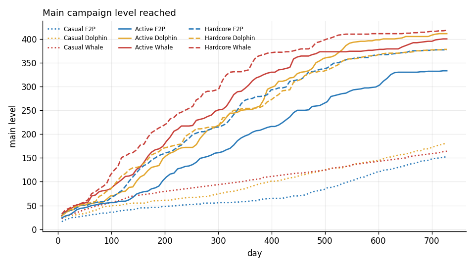
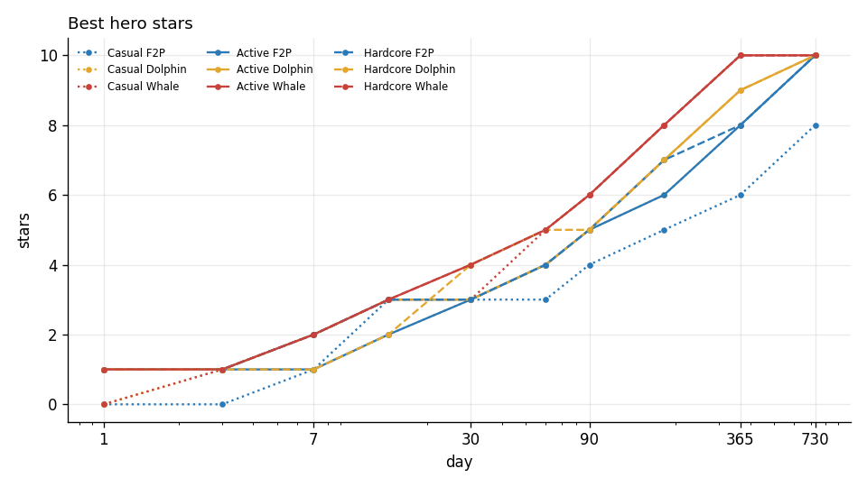
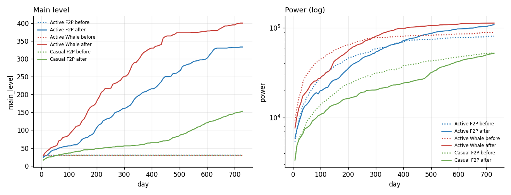

# Rogue Stars — meta-progression simulation and balance pass

Generated with `tools/RogueStars.Sim` (bots playing the real rules engine for 730 days) plus hand-written findings.
Raw medians per checkpoint: `docs/balance/data/<time>_<spend>.csv` (after the balance pass) and `*_before.csv`
(content before this pass), weekly series `data/weekly*.csv`, full generated analysis `data/analysis*.md`.

## How the simulator works

```
DOTNET_CLI_TELEMETRY_OPTOUT=1 arch -arm64 ~/.dotnet/dotnet run --project tools/RogueStars.Sim -c Release -- \
    [--days 730] [--seeds 3] [--profiles Active:F2P,Hardcore:Whale] [--label before] [--out docs/balance] [--quiet]
<venv>/bin/python tools/RogueStars.Sim/charts.py docs/balance [before_label] [after_label]   # matplotlib, local venv
```
All 9 profiles × 3 seeds × 730 days take ~9 minutes on 10 cores (one simulation per core, deterministic by seed).
The guard test `tools/RogueStars.Sim.Tests/ProgressionGuardTests` (60 days, Active F2P + Active Whale, ~10 s) runs with
the solution tests.

- **Real rules only.** Every state change is a `GameEngine.Execute` command (≈0.1–1.7 M per account over two years).
  Server-only commands are issued the way the server issues them: `PurchaseStart`/`PurchaseComplete` with dev receipts
  (offline mode), `ArenaFightResult`/`ArenaWeekEnd`, `InvasionRecordDamage`/`LiveOpsApplyOutcome`, `GuildSetMembership`.
  Battles outside runs use `BattleSimulator.PlayerVsSnapshot` / `PlayerVsBoss` like the server. Runs are played with
  `RunAutoStep` (drafts, events, shops on auto) plus the bot's revive, double-reward-ad and Burrow descend/cash-out
  choices.
- **Time profiles** (sessions at fixed UTC hours ±15 min): Casual 2 × 7.5 min, Active 4 × 15 min, Hardcore 7 × 26 min.
  Actions cost session time: session 0.5 min, daily claims 0.5, city round 0.75, upgrade round 0.5, a pull 0.15,
  an ad 0.5 (No Ads: 2 s), an arena fight 0.75, an invasion attempt 1.0. **A run costs what happened in it**:
  20 s + 2.5 s per roll + 3 s per draft/event/shop popup + 1.6 s per battle round ÷ battle speed (×2 free,
  ×3 with the monthly pass) — typically 2–3.5 minutes. Runs stop when the session ends or stamina (incl. allowed
  refills: daily free, ads up to cap, Diamonds 1/2/5 per day for F2P/Dolphin/Whale) runs out. Casual players are
  time-limited, Hardcore players stamina-limited.
- **Spend profiles:** F2P; Dolphin (No Ads, Daily Diamonds, monthly pass, season pass); Whale (the same + $300/month,
  spread evenly over the month: starter packs, funds, flash/gift/rolling offers, then the biggest Diamond packs; Diamonds
  go to refills, timer rushes, weekly token packs and 10-pulls on the Star Knight / mount banners).
- **Policy (greedy but reasonable):** frontier run when promising (after a loss: retry once power grew 1% or the next
  day), otherwise farm the best reward-per-stamina level with a ≥ 70% recent win rate; Overcharged and Dark Side
  frontiers; Burrow with keys; claims of login/quests/chests/mail/passes/funds/daily products; ads up to the caps
  (Casual 50%); cheapest-first spending of Biomass (talents, worm levels) and Ore (equipped part levels) with the city
  allowed up to half the balance per upgrade (the cheapest one may take all) and the lab's next research kept in
  reserve; quick-merge + manual Mythic merges, best-part equip, runes (merge, socket), Forge, S/SS; hero/mount unlocks,
  stars, levels, best equipped; alien squad by combat power, workers by work power, star/level ups; breeding the best
  squad alien until its genes are good (plus two cheap breeds a week for the quest); gacha: daily token packs
  (cheapest Diamonds per pull), all tokens, ad pulls, Diamond 10-pulls above a reserve.
- **Other players** are modelled in two places only. Arena: a *snapshot ladder* — the player's own loadout scaled by a
  league factor (0.86 + 0.055 × league, ±15%), weekly rank from points against a N(1000, 120) group. Invasions: the
  invader is the content boss at 2.5× the player's frontier threat with an unlimited HP pool; the group is 19 synthetic
  members (0–6 attempts, log-normal scores around the player's), repelled at ≥ 40 group attempts. So whales do not
  dominate arena leagues in the sim.

## Headline numbers (after the balance pass, median of 3 seeds)

| Profile | main level d7 / d30 / d90 / d365 / d730 | Power d7 / d30 / d90 / d365 / d730 | spent by d730 |
|---|---|---|---|
| Casual F2P | 16 / 25 / 34 / 60 / 153 | 3.4k / 6.2k / 10.4k / 23.1k / 52.5k | $0 |
| Casual Dolphin | 23 / 29 / 48 / 91 / 181 | 5.0k / 9.0k / 15.6k / 40.2k / 70.9k | $409 |
| Casual Whale | 22 / 33 / 54 / 104 / 164 | 6.2k / 11.9k / 21.3k / 51.7k / 92.8k | $7 687 |
| Active F2P | 24 / 37 / 55 / 205 / 335 | 5.9k / 11.3k / 18.4k / 65.5k / 109.5k | $0 |
| Active Dolphin | 28 / 43 / 62 / 253 / 411 | 7.8k / 13.5k / 22.9k / 79.5k / 113.7k | $409 |
| Active Whale | 29 / 47 / 82 / 313 / 400 | 7.7k / 15.8k / 27.1k / 95.1k / 113.1k | $7 695 |
| Hardcore F2P | 29 / 44 / 58 / 275 / 377 | 7.4k / 12.1k / 23.7k / 92.6k / 118.5k | $0 |
| Hardcore Dolphin | 29 / 48 / 80 / 254 / 378 | 7.2k / 16.4k / 29.7k / 93.7k / 119.6k | $409 |
| Hardcore Whale | 32 / 51 / 96 / 351 / 418 | 9.0k / 16.4k / 31.8k / 97.6k / 120.0k | $7 695 |

Long-haul targets: hero 10★ — Active F2P ≈ day 700, Casual F2P 8★ at day 730, whales ≈ day 365. Mount 5★ for F2P by
day ~180, full awakening (5) not reached by any F2P in two years (awakening 4). Mythics per pull type per week: Active
F2P ≈ 1.5, Casual F2P ≈ 0.7 (hidden pity at 50 pulls). Mythic+3 on all six parts: Active F2P just before day 730 (13.8 average), whales between day 365 and 730. Main campaign: 500 levels; Active F2P is at ~205 after a year and ~335 after two, Active whales reach ~400 around
day 550. Campaign main-level medians are noisy between neighbouring profiles (e.g. Casual Whale vs Casual Dolphin:
whales spend Casual session minutes on pulls); Power is the steadier measure.






## Before → after

Before = content at the start of this pass (30 main levels, no mount duplicates, no awaken cores, 2 lab levels …),
same bot. Every profile hit the end of the campaign (level 30) by day 7–90, the Dark Side (gated at 40) was
unreachable, mounts never left 1★, S/SS awakening never happened, the lab was done by day ~20, and power went flat
(55–69% of 4-week windows < 1% growth) in year two for Active profiles.

| Profile | main level d30 / d90 / d365 / d730 before → after | Power d365 / d730 before → after |
|---|---|---|
| Casual F2P | 26 / 30 / 30 / 30 → 25 / 34 / 60 / 153 | 34.1k / 52.7k → 23.1k / 52.5k |
| Active F2P | 30 / 30 / 30 / 30 → 37 / 55 / 205 / 335 | 65.7k / 81.5k → 65.5k / 109.5k |
| Active Whale | 30 / 30 / 30 / 30 → 47 / 82 / 313 / 400 | 79.6k / 89.1k → 95.1k / 113.1k |
| Hardcore F2P | 30 / 30 / 30 / 30 → 44 / 58 / 275 / 377 | 74.3k / 92.8k → 92.6k / 118.5k |
| Hardcore Whale | 30 / 30 / 30 / 30 → 51 / 96 / 351 / 418 | 85.0k / 102.6k → 97.6k / 120.0k |

Flags over all 9 profiles (same analysis code): walls 256 → 196, caps/never-progressed 49 → 14, hoarding/no-income
43 → 31; Active F2P flat year-two power 57% → 12% of 4-week windows. Early power is a bit lower after the pass (parts
no longer reach Mythic in month one); late power is higher because systems keep progressing. Whale mythic pulls drop
(1 735 → 1 206 by day 730) because a quarter of Blueprint Signal outcomes are now mount copies.



## Findings

**Walls** (longest stretch without a meaningful upgrade per system; limits 7 / 14 / 21 / 35 days for the windows
1–60 / 61–180 / 181–365 / 366–730; full table at the end):
- Campaign: smooth after the pass (Active F2P ≤ 11 days without a new level until day 365, ≤ 27 in year two). A soft
  plateau remains at main levels ~50–60 for Active F2P around days 60–130 (the 0.5 threat steps per level band right
  after the original three portals). Before: a hard cap at level 30.
- Heroes: one star every 2–5 weeks in year one, 6–10 weeks towards 10★ — the intended long haul (1 100 shards for the
  last star). Whales are done at ~day 365 and then pull only for collection bonuses (128-day gap in year two).
- Mounts (new source): steady to 5★ in ~3–6 months; awakening steps 5–9 weeks apart in year two.
- Laboratory (60 research levels now): 2–7 week gaps while level 3/4 research runs in the single slot; done by day
  ~130–180 for Active, ~730 for Casual. Before: done in 2–3 weeks.
- Part levels: 6–7 week gaps in days 61–180 for F2P (Ore goes to buildings first); Gear Cores are no longer the limit.
- Breeding (kept children): stops once squad genes reach the target — a natural cap of the gene range, not Grain.

**Early caps / stalls:** Dark Side has only 10 levels (cleared by day ~180–365 for Active/Hardcore); Laboratory maxed
at day ~130–180 (Active); whales max heroes (≈ d365), mount stars (≈ d30), parts Mythic+3 (d365–730) and aliens (9.8★ average by d730).

**Hoarding:** Gear Cores and Advancement Plates still pile up late (265–430 days of income banked at day 730, < 20%
spent) once every equipped part is level- and cap-maxed; Part Awaken Cores after all six parts are SS (sink
exhausted); whales/dolphins bank Hero XP (equipped hero maxed) and Fuel (mount level cap). Casual players bank
stamina from quest/login rewards (they are time-limited, not stamina-limited).

**Starvation:** Biomass and Ore are spent fully every day by every profile (≈ 100% of income) — they are the real
pacing currencies (worm levels, buildings, part levels). F2P Diamonds sit at the reserve because the daily token packs
absorb them.

**F2P vs whale:** whale/F2P power ratio (Active) 1.30 at day 7, 1.47 at day 90, 1.45 at day 365, then **1.03 at day
730**; campaign 1.21 → 1.49 → 1.53 → 1.19. Whales are clearly faster in year one, but F2P catches up in year two
because the whale has maxed most collections — pulls stop adding power (collection bonuses only). Hardcore F2P is
close to a whale at day 365 (ratio 1.05): stamina, not money, limits progress at 3 h/day.

**Power curve:** decelerating and never flat in year one for anyone (weekly growth 21–35% in days 1–60, 3–6% in 61–180,
1.4–3% in 181–365); in year two 0.3–1.6% per week with 12–47% flat 4-week windows for Active/Hardcore profiles (whales
45–47%).

## Tuning applied (content numbers, not logic)

| Area | Before | After | Why |
|---|---|---|---|
| Main campaign | 3 portals, 30 levels, threat = level − 1 | 50 portals / 500 levels from 4 biome templates (`ContentDb.Campaign`); threat steps per level 1 (levels 1–30), then 0.5, 0.2, 0.12, 0.12, 0.1, 0.08, 0.07, 0.06 per 30 levels (fractions as enemy HP/ATK %), void biome −25%, stamina 5 + portal (max 10), rewards × (portal + 1) | Dark Side (gate 40) unreachable, campaign over in a week; one curve step per level outpaces power after year one; void-biome spikes made the campaign stair-stepped |
| Dark Side | threat 30 + 2·(i−1) | starts 5 steps below its gate level (`DarkSideFromLevel` = 40) | follows the new curve |
| Mounts | no duplicate source | ~25% of Blueprint Signal outcomes are mount copies (1/1/2/5/10 by tier, first copy unlocks), "Lancer Shipyard" mount banner (15 copies); awakening shards 1 620 → 1 040, cores 1 300 → 2 500; Mount Cores from Burrow floors 6+ and Dark Side clears | mounts never left 1★; Fuel hoarded |
| Part awakening | no Part Awaken Core source; S/SS 20/60 | Burrow floor 10, Dark Side clears and Dark Side loot; S/SS 40/150 | S/SS impossible |
| Part ladder | Mythic+1/+2/+3: 1 / 2 / 1+1 Mythic | 3 / 4 / 1 same + 5 Mythic of the same kind | all parts near Mythic+3 by ~day 365 for F2P |
| Part levels | Gear Cores 1 + (L−20)/8 from 20; cap raises 5…80 plates; Forge 40/120 cores | 2·(L−9)^1.25 from level 10; 60…1 600 plates; Forge 400/1 200 cores; Gear Works 6 → 2/h, run Gear Cores halved; Plate Foundry 1.5 → 0.5/h; Burrow plate loot halved | 1.2 M Gear Cores / 216 k plates banked unused |
| Laboratory | 2 levels per line (24 total) | 5 levels (60 total), up to 40 k Biomass / 20 k Ore and 48 h | done in ~2 weeks |
| Buildings | cost ×1.35 and time ×1.22 per level, max level 8 + 2/★ | ×1.2 and ×1.12, max level 12 + 2/★ | city stalled for months (cost growth far above income) |
| Aliens | level Grain base 20…100, ×1.1 per level | 80…400, ×1.065 | level wall at ~day 90 (×1.1), then Grain hoarding |
| Fuel Refinery | 25/h | 15/h | Fuel hoarding |

## Remaining recommendations

1. **Late-game ceilings for spenders** (largest gap): whales cap heroes, parts, mount stars and aliens in 12–18 months
   and their power flattens (whale/F2P ratio 1.03 at day 730). Add ceiling content on a schedule (new heroes, mounts,
   blueprints, alien species through the banner rotation), a star tier beyond 10★ / awakening beyond 5, or stronger
   collection bonuses per duplicate, so pulls keep converting into power for years.
2. **Dark Side:** 10 levels are cleared within 6–12 months; generate it from the campaign curve like the main portals
   (30+ levels, leaderboard seasons).
3. **Laboratory:** a second research slot from a building boon or more lines; it is done by month 5 for Active players.
4. **Gear Cores / plates / Part Awaken Cores:** after parts are maxed they have no sink — add a late sink (rune rerolls,
   set bonuses, part transmute) or taper their income at max.
5. **Campaign band 31–60** (0.5 steps per level) is a soft plateau for Active F2P in months 2–4; consider 0.4.
6. **Casual stamina:** quest/login stamina rewards pile up unused for 15-minute players (16 k banked); consider turning
   overflow stamina into run-reward boosts.
7. Arena and invasion outcomes use synthetic opponents; once live, replace the snapshot ladder with real snapshot
   distributions per league to measure whale pressure in PvP.

## Guard test

`ProgressionGuardTests` (Active F2P and Active Whale, seed 1, 60 days): main level bands at day 7/30/60 (F2P 18–32 /
32–55 / 40–75, whale 20–40 / 40–75 / 50–100), no wall longer than 7–28 days per system in the first 60 days, whale/F2P
power ratio 1.15–2.6 at days 30 and 60, F2P not maxed early (hero ≤ 6★, mount ≤ 4★, parts below Mythic+2 on average,
lab incomplete), 5–16 mythics per pull type in 60 days, and determinism by seed. Move a band only after re-running the
simulator and updating this report.

## Generated tables (after the balance pass)

**Worm level** (median)

| Profile | d1 | d7 | d30 | d90 | d180 | d365 | d730 |
|---|---|---|---|---|---|---|---|
| Casual F2P | 3 | 14 | 29 | 50 | 67 | 86 | 120 |
| Casual Dolphin | 3 | 19 | 30 | 47 | 58 | 84 | 125 |
| Casual Whale | 5 | 19 | 29 | 45 | 64 | 95 | 135 |
| Active F2P | 14 | 31 | 44 | 65 | 83 | 119 | 157 |
| Active Dolphin | 16 | 27 | 43 | 59 | 89 | 126 | 156 |
| Active Whale | 15 | 27 | 43 | 62 | 96 | 137 | 162 |
| Hardcore F2P | 24 | 35 | 51 | 72 | 104 | 143 | 178 |
| Hardcore Dolphin | 25 | 28 | 50 | 73 | 108 | 147 | 182 |
| Hardcore Whale | 27 | 27 | 45 | 70 | 111 | 147 | 180 |

**Best hero stars** (median)

| Profile | d1 | d7 | d30 | d90 | d180 | d365 | d730 |
|---|---|---|---|---|---|---|---|
| Casual F2P | 0 | 1 | 3 | 4 | 5 | 6 | 8 |
| Casual Dolphin | 0 | 1 | 3 | 5 | 6 | 8 | 10 |
| Casual Whale | 0 | 2 | 3 | 6 | 8 | 10 | 10 |
| Active F2P | 1 | 1 | 3 | 5 | 6 | 8 | 10 |
| Active Dolphin | 1 | 2 | 3 | 5 | 7 | 9 | 10 |
| Active Whale | 1 | 2 | 4 | 6 | 8 | 10 | 10 |
| Hardcore F2P | 1 | 2 | 3 | 5 | 7 | 8 | 10 |
| Hardcore Dolphin | 1 | 1 | 4 | 5 | 7 | 9 | 10 |
| Hardcore Whale | 1 | 2 | 4 | 6 | 8 | 10 | 10 |

**Star Knight (whale target) stars** (median)

| Profile | d1 | d7 | d30 | d90 | d180 | d365 | d730 |
|---|---|---|---|---|---|---|---|
| Casual F2P | 0 | 1 | 3 | 4 | 5 | 6 | 8 |
| Casual Dolphin | 0 | 1 | 3 | 5 | 6 | 8 | 10 |
| Casual Whale | 0 | 2 | 3 | 5 | 7 | 9 | 10 |
| Active F2P | 1 | 1 | 2 | 4 | 6 | 8 | 10 |
| Active Dolphin | 1 | 1 | 3 | 4 | 6 | 8 | 10 |
| Active Whale | 1 | 1 | 3 | 6 | 8 | 10 | 10 |
| Hardcore F2P | 1 | 2 | 3 | 4 | 6 | 8 | 10 |
| Hardcore Dolphin | 1 | 1 | 2 | 5 | 7 | 9 | 10 |
| Hardcore Whale | 1 | 1 | 3 | 5 | 8 | 10 | 10 |

**Best mount stars** (median)

| Profile | d1 | d7 | d30 | d90 | d180 | d365 | d730 |
|---|---|---|---|---|---|---|---|
| Casual F2P | 0 | 2 | 3 | 4 | 5 | 5 | 5 |
| Casual Dolphin | 0 | 2 | 2 | 4 | 5 | 5 | 5 |
| Casual Whale | 0 | 3 | 5 | 5 | 5 | 5 | 5 |
| Active F2P | 1 | 2 | 3 | 4 | 5 | 5 | 5 |
| Active Dolphin | 1 | 3 | 3 | 5 | 5 | 5 | 5 |
| Active Whale | 1 | 3 | 5 | 5 | 5 | 5 | 5 |
| Hardcore F2P | 1 | 2 | 3 | 5 | 5 | 5 | 5 |
| Hardcore Dolphin | 2 | 2 | 3 | 5 | 5 | 5 | 5 |
| Hardcore Whale | 2 | 2 | 5 | 5 | 5 | 5 | 5 |

**Avg equipped part rarity (0 Common … 7 Legendary … 11 Mythic … 14 Mythic+3)** (median)

| Profile | d1 | d7 | d30 | d90 | d180 | d365 | d730 |
|---|---|---|---|---|---|---|---|
| Casual F2P | 0.67 | 5.5 | 8 | 10.33 | 11.33 | 12.33 | 13.17 |
| Casual Dolphin | 3.17 | 7.17 | 9.83 | 11.17 | 12 | 12.83 | 13.5 |
| Casual Whale | 4.33 | 8.33 | 10.83 | 12 | 12.67 | 13.5 | 14 |
| Active F2P | 3.5 | 7.5 | 10.5 | 11.67 | 12.33 | 13.17 | 13.83 |
| Active Dolphin | 3.33 | 8.5 | 10.33 | 11.67 | 12.67 | 13.33 | 14 |
| Active Whale | 3.17 | 8 | 10.33 | 12.33 | 13 | 13.67 | 14 |
| Hardcore F2P | 5 | 8.5 | 10.33 | 11.83 | 12.83 | 13.5 | 14 |
| Hardcore Dolphin | 5.67 | 8.33 | 10.5 | 12.17 | 12.83 | 13.5 | 14 |
| Hardcore Whale | 6.17 | 9.5 | 10.83 | 12.5 | 13.33 | 13.83 | 14 |

**Avg building level** (median)

| Profile | d1 | d7 | d30 | d90 | d180 | d365 | d730 |
|---|---|---|---|---|---|---|---|
| Casual F2P | 3 | 4.64 | 11.88 | 15.08 | 17.78 | 21 | 23.9 |
| Casual Dolphin | 2.5 | 5.29 | 11.17 | 15.54 | 18.79 | 22.17 | 24.69 |
| Casual Whale | 1.67 | 4.83 | 11.11 | 18.52 | 23.21 | 25.66 | 26.24 |
| Active F2P | 2.43 | 9.62 | 15.23 | 17.11 | 20.28 | 23.38 | 27.9 |
| Active Dolphin | 1.88 | 12.76 | 16.13 | 18.97 | 21.83 | 24.48 | 30.1 |
| Active Whale | 1.75 | 12.36 | 16.14 | 22.21 | 24.76 | 26.21 | 30.76 |
| Hardcore F2P | 2.89 | 13.13 | 16.3 | 19.21 | 22.45 | 25.03 | 30.83 |
| Hardcore Dolphin | 3.1 | 15.63 | 15.75 | 20.28 | 23.24 | 27.69 | 31.38 |
| Hardcore Whale | 3.1 | 14.76 | 17.35 | 23.38 | 24.9 | 29.52 | 31.72 |

**Avg alien stars** (median)

| Profile | d1 | d7 | d30 | d90 | d180 | d365 | d730 |
|---|---|---|---|---|---|---|---|
| Casual F2P | 0 | 1.5 | 2.25 | 3.31 | 4.69 | 6.5 | 8.38 |
| Casual Dolphin | 0 | 1.85 | 2.94 | 4.75 | 6.19 | 7.94 | 9.25 |
| Casual Whale | 0 | 2 | 3.81 | 5.94 | 7.56 | 9 | 9.75 |
| Active F2P | 1.14 | 1.92 | 2.63 | 4.44 | 6.13 | 8.25 | 9.38 |
| Active Dolphin | 1 | 2.07 | 3.13 | 5 | 7.06 | 8.56 | 9.63 |
| Active Whale | 1.2 | 2.07 | 3.75 | 6.06 | 7.88 | 9.25 | 9.81 |
| Hardcore F2P | 1.29 | 1.79 | 2.88 | 4.88 | 6.81 | 8.44 | 9.69 |
| Hardcore Dolphin | 1.13 | 2.14 | 3.38 | 5.56 | 7.38 | 8.75 | 9.81 |
| Hardcore Whale | 1.14 | 2.13 | 4 | 6.56 | 8.19 | 9.56 | 10 |

**Mythic pulls (all types)** (median)

| Profile | d1 | d7 | d30 | d90 | d180 | d365 | d730 |
|---|---|---|---|---|---|---|---|
| Casual F2P | 0 | 1 | 7 | 22 | 44 | 103 | 241 |
| Casual Dolphin | 0 | 5 | 16 | 44 | 85 | 184 | 397 |
| Casual Whale | 1 | 10 | 35 | 105 | 220 | 463 | 970 |
| Active F2P | 0 | 5 | 17 | 47 | 102 | 232 | 519 |
| Active Dolphin | 0 | 9 | 22 | 61 | 138 | 296 | 684 |
| Active Whale | 1 | 12 | 41 | 119 | 250 | 547 | 1206 |
| Hardcore F2P | 1 | 5 | 17 | 57 | 136 | 314 | 826 |
| Hardcore Dolphin | 1 | 9 | 27 | 82 | 175 | 409 | 1077 |
| Hardcore Whale | 2 | 11 | 43 | 128 | 281 | 647 | 1552 |

**Money spent (USD)** (median)

| Profile | d1 | d7 | d30 | d90 | d180 | d365 | d730 |
|---|---|---|---|---|---|---|---|
| Casual F2P | 0 | 0 | 0 | 0 | 0 | 0 | 0 |
| Casual Dolphin | 19.97 | 29.96 | 39.95 | 69.91 | 115 | 220 | 409 |
| Casual Whale | 29.91 | 99.78 | 339 | 967 | 1909 | 3858 | 7687 |
| Active F2P | 0 | 0 | 0 | 0 | 0 | 0 | 0 |
| Active Dolphin | 19.97 | 29.96 | 39.95 | 69.91 | 115 | 220 | 409 |
| Active Whale | 29.91 | 99.77 | 339 | 968 | 1911 | 3862 | 7695 |
| Hardcore F2P | 0 | 0 | 0 | 0 | 0 | 0 | 0 |
| Hardcore Dolphin | 19.97 | 29.96 | 39.95 | 69.91 | 115 | 220 | 409 |
| Hardcore Whale | 29.91 | 99.77 | 339 | 968 | 1911 | 3862 | 7695 |

**Minutes played per day** (median)

| Profile | d1 | d7 | d30 | d90 | d180 | d365 | d730 |
|---|---|---|---|---|---|---|---|
| Casual F2P | 15.01 | 16.85 | 16.23 | 16.68 | 16.78 | 16.72 | 16.61 |
| Casual Dolphin | 15.3 | 16.17 | 15.95 | 15.94 | 15.85 | 15.87 | 15.87 |
| Casual Whale | 15.44 | 16.54 | 16.54 | 16.43 | 16.19 | 15.98 | 16.06 |
| Active F2P | 63.78 | 60.64 | 61.46 | 62.18 | 62.21 | 62.21 | 62.06 |
| Active Dolphin | 62 | 60.87 | 60.53 | 60.88 | 60.96 | 61.05 | 60.99 |
| Active Whale | 61.93 | 62.32 | 60.79 | 60.83 | 60.75 | 60.86 | 60.93 |
| Hardcore F2P | 134 | 130 | 134 | 138 | 140 | 144 | 153 |
| Hardcore Dolphin | 127 | 121 | 120 | 130 | 135 | 142 | 154 |
| Hardcore Whale | 147 | 121 | 125 | 137 | 147 | 157 | 164 |


### Checkpoint day 7

| Metric | Casual F2P | Casual Dolphin | Casual Whale | Active F2P | Active Dolphin | Active Whale | Hardcore F2P | Hardcore Dolphin | Hardcore Whale |
|---|---|---|---|---|---|---|---|---|---|
| Power | 3362 | 4960 | 6198 | 5929 | 7783 | 7680 | 7354 | 7197 | 8982 |
| Main level | 16 | 23 | 22 | 24 | 28 | 29 | 29 | 29 | 32 |
| OC cleared | 0 | 0 | 0 | 16 | 20 | 19 | 21 | 20 | 22 |
| Burrow floors | 0 | 0 | 0 | 0 | 76 | 90 | 84 | 109 | 120 |
| Dark Side | 0 | 0 | 0 | 0 | 0 | 0 | 0 | 0 | 0 |
| Worm lv | 14 | 19 | 19 | 31 | 27 | 27 | 35 | 28 | 27 |
| Talent tier | 2 | 2 | 2 | 4 | 4 | 4 | 4 | 4 | 4 |
| Part rarity avg | 5.5 | 7.17 | 8.33 | 7.5 | 8.5 | 8 | 8.5 | 8.33 | 9.5 |
| Part lv avg | 6.33 | 13.33 | 14.33 | 12.33 | 21.17 | 20.83 | 19.67 | 20.17 | 22.83 |
| Rune slots | 9 | 11 | 13 | 12 | 14 | 12 | 13 | 13 | 15 |
| Rune rarity | 1.43 | 1.54 | 1.92 | 2.1 | 1.92 | 1.75 | 1.93 | 2.23 | 2.13 |
| Forge | 0 | 0 | 0 | 0 | 0 | 0 | 0 | 0 | 0 |
| S parts | 0 | 0 | 0 | 0 | 0 | 0 | 0 | 0 | 0 |
| Hero ★ best | 1 | 1 | 2 | 1 | 2 | 2 | 2 | 1 | 2 |
| Hero ★ avg | 1 | 1 | 1.5 | 1 | 1.5 | 1.5 | 1.33 | 1 | 1.5 |
| Heroes | 1 | 3 | 2 | 1 | 2 | 2 | 1 | 4 | 3 |
| Mount ★ | 2 | 2 | 3 | 2 | 3 | 3 | 2 | 2 | 2 |
| Mount awaken | 0 | 0 | 0 | 0 | 0 | 0 | 0 | 0 | 0 |
| Blueprints | 12 | 17 | 25 | 13 | 20 | 23 | 16 | 20 | 22 |
| BP ★ avg | 1.58 | 1.79 | 2.28 | 1.85 | 2.11 | 2.32 | 2.13 | 2 | 2.19 |
| Buildings | 11 | 14 | 22 | 13 | 20 | 23 | 15 | 19 | 21 |
| Bld lv avg | 4.64 | 5.29 | 4.83 | 9.62 | 12.76 | 12.36 | 13.13 | 15.63 | 14.76 |
| Biomass/h | 258 | 654 | 937 | 751 | 1661 | 1630 | 1163 | 1460 | 1334 |
| Ore/h | 81.22 | 146 | 154 | 154 | 342 | 388 | 266 | 294 | 465 |
| Diamonds/h | 0 | 2.94 | 3.34 | 0 | 0 | 5.74 | 0 | 8.07 | 0 |
| Aliens | 13 | 13 | 15 | 14 | 15 | 15 | 15 | 14 | 15 |
| Alien ★ avg | 1.5 | 1.85 | 2 | 1.92 | 2.07 | 2.07 | 1.79 | 2.14 | 2.13 |
| Squad | 1 | 1 | 2 | 2 | 3 | 2 | 2 | 2 | 3 |
| Breeds | 1 | 3 | 2 | 7 | 4 | 3 | 3 | 4 | 3 |
| Lab | 6 | 12 | 11 | 15 | 24 | 24 | 24 | 26 | 25 |
| League | 0 | 0 | 0 | 0 | 0 | 0 | 0 | 0 | 0 |
| Invasion score | 0 | 215 | 419 | 138 | 329 | 286 | 336 | 312 | 324 |
| Mythic pulls | 1 | 5 | 10 | 5 | 9 | 12 | 5 | 9 | 11 |
| Diamonds | 786 | 357 | 598 | 719 | 344 | 15 | 707 | 389 | 10 |
| Biomass | 794 | 302 | 546 | 13.6k | 8334 | 2681 | 3328 | 5009 | 1758 |
| Ore | 127 | 270 | 240 | 56 | 1554 | 1770 | 1194 | 21.8k | 33.6k |
| Grain | 394 | 836 | 710 | 880 | 636 | 1377 | 929 | 1946 | 1475 |
| Gear cores | 152 | 49 | 190 | 126 | 54 | 288 | 296 | 27 | 21 |
| Fuel | 551 | 715 | 1104 | 147 | 673 | 1191 | 608 | 854 | 1761 |
| Hero XP | 79 | 116 | 142 | 394 | 1252 | 439 | 171 | 1577 | 919 |
| Part tokens | 0 | 0 | 0 | 0 | 0 | 0 | 0 | 0 | 0 |
| Spent $ | 0 | 29.96 | 99.78 | 0 | 29.96 | 99.77 | 0 | 29.96 | 99.77 |
| Min/day | 16.85 | 16.17 | 16.54 | 60.64 | 60.87 | 62.32 | 130 | 121 | 121 |

### Checkpoint day 30

| Metric | Casual F2P | Casual Dolphin | Casual Whale | Active F2P | Active Dolphin | Active Whale | Hardcore F2P | Hardcore Dolphin | Hardcore Whale |
|---|---|---|---|---|---|---|---|---|---|
| Power | 6170 | 8993 | 11.9k | 11.3k | 13.5k | 15.8k | 12.1k | 16.4k | 16.4k |
| Main level | 25 | 29 | 33 | 37 | 43 | 47 | 44 | 48 | 51 |
| OC cleared | 2 | 4 | 0 | 26 | 29 | 31 | 29 | 32 | 36 |
| Burrow floors | 19 | 119 | 120 | 435 | 536 | 549 | 544 | 569 | 580 |
| Dark Side | 0 | 0 | 0 | 0 | 1 | 2 | 1 | 2 | 3 |
| Worm lv | 29 | 30 | 29 | 44 | 43 | 43 | 51 | 50 | 45 |
| Talent tier | 4 | 4 | 4 | 6 | 6 | 6 | 6 | 6 | 6 |
| Part rarity avg | 8 | 9.83 | 10.83 | 10.5 | 10.33 | 10.33 | 10.33 | 10.5 | 10.83 |
| Part lv avg | 9.67 | 17.83 | 20.67 | 20.33 | 30.33 | 28.83 | 24.83 | 32.83 | 31.83 |
| Rune slots | 13 | 15 | 22 | 23 | 18 | 22 | 22 | 20 | 23 |
| Rune rarity | 1.53 | 1.94 | 2.46 | 2.19 | 2.6 | 2.55 | 2.17 | 2.82 | 2.96 |
| Forge | 0 | 0 | 5 | 6 | 2 | 7 | 6 | 4 | 7 |
| S parts | 0 | 0 | 0 | 1 | 1 | 1 | 1 | 1 | 1 |
| Hero ★ best | 3 | 3 | 3 | 3 | 3 | 4 | 3 | 4 | 4 |
| Hero ★ avg | 2 | 1.88 | 2.38 | 1.6 | 2 | 2.63 | 2.2 | 2.38 | 3 |
| Heroes | 3 | 7 | 8 | 7 | 8 | 8 | 5 | 8 | 8 |
| Mount ★ | 3 | 2 | 5 | 3 | 3 | 5 | 3 | 3 | 5 |
| Mount awaken | 0 | 0 | 0 | 0 | 0 | 1 | 0 | 0 | 1 |
| Blueprints | 18 | 24 | 29 | 21 | 23 | 29 | 25 | 26 | 29 |
| BP ★ avg | 2 | 2.1 | 3.97 | 2.32 | 2.79 | 3.93 | 2.32 | 2.65 | 3.93 |
| Buildings | 17 | 23 | 28 | 20 | 23 | 28 | 23 | 26 | 29 |
| Bld lv avg | 11.88 | 11.17 | 11.11 | 15.23 | 16.13 | 16.14 | 16.3 | 15.75 | 17.35 |
| Biomass/h | 1114 | 1244 | 2096 | 1391 | 2041 | 2700 | 1512 | 2113 | 2679 |
| Ore/h | 275 | 374 | 461 | 324 | 578 | 569 | 345 | 431 | 741 |
| Diamonds/h | 5.94 | 11.89 | 13.72 | 0 | 20.22 | 24.41 | 17.01 | 23.8 | 20.48 |
| Aliens | 15 | 16 | 16 | 16 | 16 | 16 | 16 | 16 | 16 |
| Alien ★ avg | 2.25 | 2.94 | 3.81 | 2.63 | 3.13 | 3.75 | 2.88 | 3.38 | 4 |
| Squad | 2 | 3 | 3 | 2 | 3 | 3 | 2 | 3 | 3 |
| Breeds | 14 | 11 | 10 | 15 | 12 | 11 | 11 | 12 | 17 |
| Lab | 24 | 24 | 24 | 30 | 37 | 30 | 38 | 42 | 36 |
| League | 1 | 2 | 2 | 3 | 2 | 3 | 2 | 3 | 4 |
| Invasion score | 692 | 1383 | 2608 | 936 | 1424 | 1153 | 1445 | 1266 | 1202 |
| Mythic pulls | 7 | 16 | 35 | 17 | 22 | 41 | 17 | 27 | 43 |
| Diamonds | 767 | 341 | 53 | 775 | 355 | 147 | 806 | 378 | 123 |
| Biomass | 18.2k | 10.3k | 13.9k | 13.6k | 11.9k | 15.9k | 24.7k | 17.4k | 45.8k |
| Ore | 429 | 1403 | 519 | 1172 | 3655 | 395 | 2214 | 2715 | 5716 |
| Grain | 1229 | 1815 | 2447 | 669 | 718 | 768 | 1233 | 1068 | 2237 |
| Gear cores | 522 | 2639 | 681 | 2091 | 6504 | 3036 | 6259 | 4351 | 4197 |
| Fuel | 588 | 937 | 892 | 1571 | 1148 | 3376 | 891 | 2820 | 1493 |
| Hero XP | 791 | 1838 | 3564 | 2347 | 1160 | 2717 | 2111 | 533 | 1380 |
| Part tokens | 0 | 0 | 0 | 0 | 0 | 0 | 0 | 0 | 0 |
| Spent $ | 0 | 39.95 | 339 | 0 | 39.95 | 339 | 0 | 39.95 | 339 |
| Min/day | 16.23 | 15.95 | 16.54 | 61.46 | 60.53 | 60.79 | 134 | 120 | 125 |

### Checkpoint day 90

| Metric | Casual F2P | Casual Dolphin | Casual Whale | Active F2P | Active Dolphin | Active Whale | Hardcore F2P | Hardcore Dolphin | Hardcore Whale |
|---|---|---|---|---|---|---|---|---|---|
| Power | 10.4k | 15.6k | 21.3k | 18.4k | 22.9k | 27.1k | 23.7k | 29.7k | 31.8k |
| Main level | 34 | 48 | 54 | 55 | 62 | 82 | 58 | 80 | 96 |
| OC cleared | 4 | 6 | 0 | 41 | 45 | 53 | 45 | 51 | 58 |
| Burrow floors | 170 | 489 | 478 | 1635 | 1736 | 1749 | 1744 | 1769 | 1780 |
| Dark Side | 0 | 0 | 0 | 4 | 5 | 7 | 4 | 7 | 8 |
| Worm lv | 50 | 47 | 45 | 65 | 59 | 62 | 72 | 73 | 70 |
| Talent tier | 6 | 6 | 6 | 8 | 8 | 8 | 9 | 9 | 9 |
| Part rarity avg | 10.33 | 11.17 | 12 | 11.67 | 11.67 | 12.33 | 11.83 | 12.17 | 12.5 |
| Part lv avg | 9.33 | 30.17 | 30.5 | 24.33 | 36.67 | 34.67 | 28.33 | 44.83 | 41.33 |
| Rune slots | 22 | 17 | 24 | 24 | 22 | 24 | 24 | 24 | 24 |
| Rune rarity | 2.04 | 3 | 3.38 | 3.05 | 3.23 | 3.42 | 3.21 | 3.65 | 4 |
| Forge | 6 | 0 | 10 | 6 | 4 | 12 | 7 | 7 | 12 |
| S parts | 0 | 1 | 1 | 4 | 5 | 5 | 5 | 5 | 5 |
| Hero ★ best | 4 | 5 | 6 | 5 | 5 | 6 | 5 | 5 | 6 |
| Hero ★ avg | 2.25 | 3.75 | 4.63 | 3.38 | 4 | 4.88 | 3.38 | 4.25 | 5 |
| Heroes | 8 | 8 | 8 | 8 | 8 | 8 | 8 | 8 | 8 |
| Mount ★ | 4 | 4 | 5 | 4 | 5 | 5 | 5 | 5 | 5 |
| Mount awaken | 0 | 0 | 1 | 0 | 0 | 2 | 0 | 1 | 2 |
| Blueprints | 28 | 29 | 29 | 28 | 29 | 29 | 29 | 29 | 29 |
| BP ★ avg | 2.71 | 2.93 | 6.1 | 3.11 | 3.79 | 6.28 | 4.03 | 4.66 | 6.52 |
| Buildings | 25 | 28 | 29 | 28 | 29 | 29 | 29 | 29 | 29 |
| Bld lv avg | 15.08 | 15.54 | 18.52 | 17.11 | 18.97 | 22.21 | 19.21 | 20.28 | 23.38 |
| Biomass/h | 1521 | 2019 | 3757 | 2104 | 3206 | 4594 | 2519 | 3363 | 4499 |
| Ore/h | 260 | 332 | 485 | 329 | 612 | 558 | 374 | 479 | 892 |
| Diamonds/h | 6.81 | 12.49 | 14.26 | 13.83 | 17.2 | 22.56 | 11.91 | 18.88 | 19.64 |
| Aliens | 16 | 16 | 16 | 16 | 16 | 16 | 16 | 16 | 16 |
| Alien ★ avg | 3.31 | 4.75 | 5.94 | 4.44 | 5 | 6.06 | 4.88 | 5.56 | 6.56 |
| Squad | 2 | 3 | 3 | 3 | 3 | 3 | 3 | 3 | 3 |
| Breeds | 31 | 34 | 40 | 37 | 34 | 35 | 35 | 40 | 35 |
| Lab | 26 | 36 | 36 | 48 | 50 | 48 | 51 | 59 | 60 |
| League | 2 | 3 | 4 | 4 | 3 | 4 | 3 | 5 | 3 |
| Invasion score | 3397 | 6235 | 14.1k | 5007 | 8704 | 6808 | 6977 | 8401 | 9366 |
| Mythic pulls | 22 | 44 | 105 | 47 | 61 | 119 | 57 | 82 | 128 |
| Diamonds | 768 | 322 | 437 | 769 | 328 | 741 | 780 | 380 | 46 |
| Biomass | 40.9k | 18.4k | 26k | 51.9k | 54.7k | 75.4k | 87k | 41.6k | 89.8k |
| Ore | 655 | 2426 | 4092 | 6337 | 7479 | 9506 | 1685 | 4854 | 3076 |
| Grain | 2128 | 4396 | 7034 | 1952 | 4215 | 1864 | 5761 | 4173 | 4025 |
| Gear cores | 5055 | 10.1k | 5004 | 26.9k | 30.2k | 26.7k | 33.5k | 27.1k | 38.5k |
| Fuel | 4653 | 1764 | 1614 | 6730 | 2910 | 6472 | 3531 | 1405 | 7204 |
| Hero XP | 4297 | 237 | 2434 | 3652 | 3856 | 4076 | 10.2k | 4544 | 7630 |
| Part tokens | 0 | 0 | 0 | 0 | 0 | 0 | 0 | 0 | 0 |
| Spent $ | 0 | 69.91 | 967 | 0 | 69.91 | 968 | 0 | 69.91 | 968 |
| Min/day | 16.68 | 15.94 | 16.43 | 62.18 | 60.88 | 60.83 | 138 | 130 | 137 |

### Checkpoint day 365

| Metric | Casual F2P | Casual Dolphin | Casual Whale | Active F2P | Active Dolphin | Active Whale | Hardcore F2P | Hardcore Dolphin | Hardcore Whale |
|---|---|---|---|---|---|---|---|---|---|
| Power | 23.1k | 40.2k | 51.7k | 65.5k | 79.5k | 95.1k | 92.6k | 93.7k | 97.6k |
| Main level | 60 | 91 | 104 | 205 | 253 | 313 | 275 | 254 | 351 |
| OC cleared | 5 | 6 | 0 | 126 | 164 | 191 | 171 | 165 | 215 |
| Burrow floors | 640 | 2199 | 2110 | 7135 | 7236 | 7249 | 7244 | 7269 | 7280 |
| Dark Side | 5 | 6 | 0 | 10 | 10 | 10 | 10 | 10 | 10 |
| Worm lv | 86 | 84 | 95 | 119 | 126 | 137 | 143 | 147 | 147 |
| Talent tier | 11 | 11 | 12 | 15 | 16 | 17 | 18 | 19 | 19 |
| Part rarity avg | 12.33 | 12.83 | 13.5 | 13.17 | 13.33 | 13.67 | 13.5 | 13.5 | 13.83 |
| Part lv avg | 17.5 | 64.67 | 66.67 | 90.33 | 115 | 124 | 121 | 124 | 128 |
| Rune slots | 24 | 18 | 24 | 24 | 24 | 24 | 24 | 24 | 24 |
| Rune rarity | 3.25 | 4 | 4 | 4 | 4 | 4 | 4 | 4 | 4 |
| Forge | 6 | 0 | 12 | 6 | 6 | 12 | 12 | 12 | 12 |
| S parts | 2 | 6 | 6 | 4 | 4 | 4 | 4 | 4 | 3 |
| Hero ★ best | 6 | 8 | 10 | 8 | 9 | 10 | 8 | 9 | 10 |
| Hero ★ avg | 5.25 | 6.63 | 8.25 | 6.88 | 7.5 | 8.75 | 7.25 | 7.75 | 9 |
| Heroes | 8 | 8 | 8 | 8 | 8 | 8 | 8 | 8 | 8 |
| Mount ★ | 5 | 5 | 5 | 5 | 5 | 5 | 5 | 5 | 5 |
| Mount awaken | 2 | 2 | 2 | 4 | 3 | 3 | 3 | 3 | 3 |
| Blueprints | 29 | 29 | 29 | 29 | 29 | 29 | 29 | 29 | 29 |
| BP ★ avg | 5.21 | 5.86 | 9.07 | 6.62 | 7.31 | 9.28 | 7.83 | 8.48 | 9.48 |
| Buildings | 29 | 29 | 29 | 29 | 29 | 29 | 29 | 29 | 29 |
| Bld lv avg | 21 | 22.17 | 25.66 | 23.38 | 24.48 | 26.21 | 25.03 | 27.69 | 29.52 |
| Biomass/h | 2770 | 4216 | 7443 | 4306 | 6676 | 7959 | 4876 | 6417 | 6988 |
| Ore/h | 464 | 541 | 779 | 668 | 1152 | 811 | 659 | 822 | 1128 |
| Diamonds/h | 17.18 | 24.7 | 30.81 | 22.82 | 30.25 | 38.54 | 25.13 | 36.65 | 35.15 |
| Aliens | 16 | 16 | 16 | 16 | 16 | 16 | 16 | 16 | 16 |
| Alien ★ avg | 6.5 | 7.94 | 9 | 8.25 | 8.56 | 9.25 | 8.44 | 8.75 | 9.56 |
| Squad | 3 | 3 | 3 | 3 | 3 | 3 | 3 | 3 | 3 |
| Breeds | 123 | 119 | 120 | 117 | 114 | 115 | 115 | 120 | 115 |
| Lab | 48 | 60 | 60 | 60 | 60 | 60 | 60 | 60 | 60 |
| League | 4 | 3 | 4 | 3 | 4 | 3 | 3 | 3 | 3 |
| Invasion score | 24.8k | 67k | 169.2k | 91.6k | 127.3k | 132.1k | 155.7k | 143.8k | 228.6k |
| Mythic pulls | 103 | 184 | 463 | 232 | 296 | 547 | 314 | 409 | 647 |
| Diamonds | 732 | 385 | 887 | 803 | 701 | 81 | 781 | 1238 | 512 |
| Biomass | 76.5k | 87.2k | 126.9k | 177.2k | 375.7k | 74.2k | 94.6k | 30.2k | 231.3k |
| Ore | 11.3k | 9544 | 4730 | 3678 | 17.9k | 7413 | 6391 | 197.4k | 8158 |
| Grain | 4776 | 3660 | 38.4k | 18.1k | 20.2k | 22.9k | 23.7k | 33.6k | 74.5k |
| Gear cores | 46.8k | 33.2k | 67.1k | 80.2k | 22.1k | 61.6k | 24.9k | 28.2k | 125.9k |
| Fuel | 11.9k | 4490 | 12.6k | 17.9k | 16.5k | 6787 | 15.9k | 12.3k | 39.6k |
| Hero XP | 18.1k | 9619 | 4284 | 25.1k | 9174 | 9270 | 20.4k | 19k | 190.9k |
| Part tokens | 0 | 0 | 0 | 0 | 0 | 0 | 0 | 0 | 0 |
| Spent $ | 0 | 220 | 3858 | 0 | 220 | 3862 | 0 | 220 | 3862 |
| Min/day | 16.72 | 15.87 | 15.98 | 62.21 | 61.05 | 60.86 | 144 | 142 | 157 |

### Checkpoint day 730

| Metric | Casual F2P | Casual Dolphin | Casual Whale | Active F2P | Active Dolphin | Active Whale | Hardcore F2P | Hardcore Dolphin | Hardcore Whale |
|---|---|---|---|---|---|---|---|---|---|
| Power | 52.5k | 70.9k | 92.8k | 109.5k | 113.7k | 113.1k | 118.5k | 119.6k | 120k |
| Main level | 153 | 181 | 164 | 335 | 411 | 400 | 377 | 378 | 418 |
| OC cleared | 15 | 6 | 0 | 212 | 278 | 256 | 248 | 252 | 291 |
| Burrow floors | 690 | 4450 | 4259 | 14.4k | 14.5k | 14.5k | 14.5k | 14.6k | 14.6k |
| Dark Side | 10 | 7 | 0 | 10 | 10 | 10 | 10 | 10 | 10 |
| Worm lv | 120 | 125 | 135 | 157 | 156 | 162 | 178 | 182 | 180 |
| Talent tier | 15 | 16 | 17 | 20 | 20 | 20 | 22 | 23 | 23 |
| Part rarity avg | 13.17 | 13.5 | 14 | 13.83 | 14 | 14 | 14 | 14 | 14 |
| Part lv avg | 71.17 | 111 | 121 | 127 | 130 | 130 | 130 | 130 | 130 |
| Rune slots | 24 | 18 | 24 | 24 | 24 | 24 | 24 | 24 | 24 |
| Rune rarity | 4 | 4 | 4 | 4 | 4 | 4 | 4 | 4 | 4 |
| Forge | 6 | 0 | 12 | 9 | 11 | 12 | 12 | 12 | 12 |
| S parts | 3 | 5 | 5 | 1 | 1 | 1 | 1 | 1 | 0 |
| Hero ★ best | 8 | 10 | 10 | 10 | 10 | 10 | 10 | 10 | 10 |
| Hero ★ avg | 7.25 | 8.63 | 9.88 | 9 | 9.38 | 10 | 9.5 | 9.88 | 10 |
| Heroes | 8 | 8 | 8 | 8 | 8 | 8 | 8 | 8 | 8 |
| Mount ★ | 5 | 5 | 5 | 5 | 5 | 5 | 5 | 5 | 5 |
| Mount awaken | 2 | 3 | 3 | 4 | 4 | 4 | 4 | 4 | 4 |
| Blueprints | 29 | 29 | 29 | 29 | 29 | 29 | 29 | 29 | 29 |
| BP ★ avg | 7.17 | 7.41 | 9.83 | 8.28 | 9.21 | 9.93 | 9.59 | 9.86 | 10 |
| Buildings | 29 | 29 | 29 | 29 | 29 | 29 | 29 | 29 | 29 |
| Bld lv avg | 23.9 | 24.69 | 26.24 | 27.9 | 30.1 | 30.76 | 30.83 | 31.38 | 31.72 |
| Biomass/h | 4155 | 5464 | 8118 | 5464 | 8802 | 8709 | 6898 | 8545 | 8215 |
| Ore/h | 715 | 744 | 796 | 749 | 1306 | 907 | 737 | 857 | 1203 |
| Diamonds/h | 11.78 | 16.59 | 18.89 | 15.43 | 24.24 | 31.18 | 20.85 | 26.48 | 24.49 |
| Aliens | 16 | 16 | 16 | 16 | 16 | 16 | 16 | 16 | 16 |
| Alien ★ avg | 8.38 | 9.25 | 9.75 | 9.38 | 9.63 | 9.81 | 9.69 | 9.81 | 10 |
| Squad | 3 | 3 | 3 | 3 | 3 | 3 | 3 | 3 | 3 |
| Breeds | 227 | 223 | 224 | 223 | 222 | 219 | 225 | 224 | 219 |
| Lab | 60 | 60 | 60 | 60 | 60 | 60 | 60 | 60 | 60 |
| League | 3 | 4 | 3 | 5 | 3 | 3 | 3 | 3 | 5 |
| Invasion score | 103.4k | 359k | 1.84M | 520.9k | 615k | 558.8k | 658k | 565k | 789.7k |
| Mythic pulls | 241 | 397 | 970 | 519 | 684 | 1206 | 826 | 1077 | 1552 |
| Diamonds | 790 | 341 | 86 | 749 | 881 | 712 | 1057 | 1027 | 1027 |
| Biomass | 167.5k | 124.4k | 250.8k | 101.4k | 369.7k | 572.1k | 152.2k | 719.2k | 480k |
| Ore | 3080 | 10.9k | 19.4k | 16.3k | 128.5k | 155.3k | 384.7k | 670.7k | 2.21M |
| Grain | 12.4k | 14.2k | 78k | 36.8k | 81.7k | 85.2k | 71.9k | 130.7k | 48.6k |
| Gear cores | 72.9k | 12.7k | 69.8k | 232.6k | 287.8k | 398.1k | 369k | 487.5k | 663.8k |
| Fuel | 4497 | 10.9k | 14.7k | 44.1k | 19.4k | 845.1k | 32.2k | 583.3k | 2.25M |
| Hero XP | 30.1k | 35.4k | 62.1k | 55.5k | 1.26M | 2.69M | 1.38M | 4.48M | 5.71M |
| Part tokens | 0 | 0 | 0 | 0 | 0 | 0 | 0 | 0 | 0 |
| Spent $ | 0 | 409 | 7687 | 0 | 409 | 7695 | 0 | 409 | 7695 |
| Min/day | 16.61 | 15.87 | 16.06 | 62.06 | 60.99 | 60.93 | 153 | 154 | 164 |

### Max days without a meaningful upgrade, per system (windows 1–60, 61–180, 181–365, 366–730)

| Profile | Campaign | Worm | Parts | PartLevels | Runes | Heroes | HeroLevels | Mounts | MountLevels | Blueprints | Buildings | Aliens | AlienLevels | Breeding | Laboratory | Arena | Invasions |
|---|---|---|---|---|---|---|---|---|---|---|---|---|---|---|---|---|---|
| Casual F2P | 7/20/25/23 | 10/9/18/22 | 3/8/13/26 | 12/46/100/59 | 9/6/8/8 | 12/18/37/77 | 13/7/11/16 | 13/38/69/224 | 4/8/13/16 | 5/8/18/39 | 0/2/6/33 | 8/12/23/55 | 2/11/3/5 | 7/13/84/365 | 34/43/99/255 | 6/2/4/4 | 12/5/5/5 |
| Casual Dolphin | 6/26/20/13 | 6/14/12/18 | 2/6/14/13 | 13/23/23/5 | 4/4/5/5 | 8/32/28/64 | 5/8/10/10 | 16/42/38/112 | 4/8/11/13 | 6/7/14/32 | 0/4/19/33 | 4/14/32/57 | 1/13/3/6 | 6/32/185/365 | 20/27/96/365 | 3/3/3/4 | 5/5/5/5 |
| Casual Whale | 5/6/6/13 | 6/10/12/17 | 1/4/5/5 | 11/24/26/4 | 2/2/2/3 | 9/17/30/107 | 3/5/8/12 | 9/29/61/114 | 4/6/7/12 | 2/10/16/74 | 0/1/47/83 | 3/13/29/84 | 6/4/4/11 | 6/53/185/365 | 21/32/78/365 | 3/2/3/5 | 5/5/5/5 |
| Active F2P | 4/11/6/27 | 7/9/7/17 | 3/6/7/8 | 9/46/2/121 | 2/3/2/3 | 11/15/28/71 | 3/4/6/7 | 13/24/36/63 | 3/4/7/11 | 4/8/12/41 | 1/4/14/22 | 6/13/30/85 | 1/4/3/4 | 13/25/175/199 | 17/47/185/365 | 1/1/1/1 | 5/5/5/5 |
| Active Dolphin | 5/7/7/24 | 7/5/8/22 | 3/4/6/6 | 6/24/3/212 | 1/2/2/2 | 5/22/45/67 | 3/3/4/122 | 12/20/35/63 | 3/4/6/7 | 5/6/21/35 | 2/7/17/22 | 4/10/30/99 | 0/4/2/5 | 20/27/185/329 | 7/54/185/365 | 1/1/1/1 | 5/5/5/5 |
| Active Whale | 3/7/15/22 | 7/7/8/25 | 1/3/4/4 | 8/21/3/291 | 1/1/1/1 | 6/17/33/128 | 2/3/5/274 | 7/19/36/63 | 3/3/6/135 | 2/13/24/68 | 0/18/20/16 | 4/12/28/156 | 2/2/2/7 | 6/55/133/338 | 15/48/185/365 | 1/1/1/1 | 5/5/5/5 |
| Hardcore F2P | 5/8/9/17 | 6/8/7/16 | 1/5/4/6 | 17/18/2/175 | 1/1/1/1 | 7/16/33/49 | 3/3/4/93 | 9/18/36/63 | 2/4/6/7 | 4/7/16/32 | 2/9/16/17 | 4/9/29/59 | 0/2/2/5 | 6/69/185/282 | 17/64/185/365 | 0/0/0/0 | 5/5/5/5 |
| Hardcore Dolphin | 6/4/8/24 | 5/6/9/18 | 2/4/5/5 | 14/7/27/163 | 0/1/1/1 | 9/16/30/134 | 1/3/5/287 | 12/17/36/63 | 3/3/5/61 | 3/6/16/69 | 1/6/13/28 | 4/9/25/104 | 4/1/1/4 | 6/60/185/365 | 18/89/185/365 | 0/0/0/0 | 5/5/5/5 |
| Hardcore Whale | 6/5/14/51 | 7/4/15/20 | 1/3/3/4 | 8/10/59/348 | 1/1/1/0 | 7/17/48/222 | 2/3/18/365 | 7/22/36/63 | 2/4/4/243 | 2/7/19/84 | 0/7/10/41 | 4/14/25/147 | 1/1/2/9 | 6/60/185/365 | 15/91/185/365 | 0/0/0/0 | 5/5/5/5 |

### Upgrades per 30 days, per system (same windows)

| Profile | Campaign | Worm | Parts | PartLevels | Runes | Heroes | HeroLevels | Mounts | MountLevels | Blueprints | Buildings | Aliens | AlienLevels | Breeding | Laboratory | Arena | Invasions |
|---|---|---|---|---|---|---|---|---|---|---|---|---|---|---|---|---|---|
| Casual F2P | 17/4.5/2.92/8.22 | 23/7/3.73/3.21 | 34/18/8.92/5.1 | 54/11.25/6.32/26.55 | 12/19/22.38/23.67 | 6/4/2.43/1.32 | 10/5/2.92/2.38 | 7/2.25/1.46/0.16 | 15.5/4.5/3.41/2.14 | 29/13/7.3/4.52 | 151/43.25/21.08/6.82 | 22/7.75/4.7/2.47 | 187/63.75/43.3/24.25 | 6/6.75/0.65/0 | 10.5/3/1.95/0.99 | 34.5/32/29.35/30.49 | 28.5/32.5/33.08/33.86 |
| Casual Dolphin | 23/5.5/5.51/7.64 | 22.5/5.25/4.86/3.7 | 47.5/20.5/11.68/14.22 | 134/20.75/30/23.26 | 30/41/42.32/43.23 | 11.5/4.25/2.11/1.32 | 12.5/4.5/4.86/3.95 | 8/2.25/2.27/0.41 | 16/5.75/3.57/4.93 | 32.5/12/9.24/3.7 | 190/44.25/15.89/5.75 | 31.5/9/4.7/1.73 | 79.5/102/61.46/21.95 | 6/7/0/0 | 12/5.25/1.95/0 | 34.5/30.5/29.35/31.07 | 33/36/36.97/35.51 |
| Casual Whale | 22/7.75/4.86/4.85 | 22/6.5/5.68/3.62 | 72.5/29/25.95/29.75 | 139/20.75/27.89/26.63 | 74/86.5/84.65/84.33 | 15/5.25/2.76/1.07 | 13/9.25/6.32/3.62 | 15.5/1/0.65/0.33 | 21.5/6/7.14/3.12 | 77.5/15.75/7.3/1.81 | 222/58.25/11.51/1.4 | 40/10.25/3.73/0.99 | 70.5/155/33.24/11.67 | 11.5/3.75/0/0 | 16/3.25/1.95/0 | 34/33.25/28.86/29.75 | 33/36/36.97/35.51 |
| Active F2P | 41/15.5/31.62/17.67 | 32/7/7.3/3.53 | 79/23.75/19.62/21.21 | 134/22.25/54.81/18 | 62.5/77.75/79.78/86.38 | 8.5/5.75/2.43/1.32 | 26.5/10/6.65/5.42 | 7.5/3.75/2.59/0.58 | 20.5/12/5.03/3.37 | 36/16.25/9.57/3.78 | 211/40.75/14.43/10.19 | 29/10/5.51/1.48 | 278/84/42.81/19.48 | 8/6.25/0.16/0.16 | 16.5/5.25/0/0 | 84.5/75.25/76.05/77.34 | 33/36/36.97/35.51 |
| Active Dolphin | 49.5/30.5/33.41/21.78 | 29/10/7.3/2.71 | 77/30/27.41/24.49 | 186/54.5/49.46/7.56 | 86.5/95.75/99.73/109 | 13/4.5/2.59/1.23 | 24/13/7.95/3.86 | 10.5/5.25/0.97/0.49 | 17.5/12.5/5.68/8.14 | 42.5/19.25/8.11/4.6 | 232/42.75/12.16/13.48 | 34.5/11.25/4.05/1.4 | 316/86.25/42.65/17.59 | 5/5.25/0/0.25 | 22.5/3/0/0 | 80.5/75.75/75.41/74.55 | 34.5/36/36.97/35.51 |
| Active Whale | 56.5/42.25/41.03/12.25 | 31/11.25/7.46/2.22 | 107/35.5/41.03/35.1 | 211/63.5/51.57/3.12 | 117/130/128/133 | 16/5.5/2.59/0.82 | 28.5/10.75/8.59/1.07 | 17.5/1.75/0.81/0.49 | 29.5/15/9.41/3.7 | 77/17.5/7.14/1.56 | 285/35/8.11/10.85 | 41/11/3.57/0.74 | 289/98.25/41.84/14.63 | 12.5/1.25/0.16/0.08 | 18/5.25/0/0 | 89/73.5/75.41/74.05 | 34.5/36/36.97/35.51 |
| Hardcore F2P | 47.5/35.75/34.7/17.34 | 35/11.5/7.14/2.96 | 103/33.25/29.35/25.97 | 173/66.75/48.16/4.27 | 127/162/173/193 | 10.5/5.75/2.76/1.48 | 27/11.5/8.27/5.75 | 9.5/5.25/0.81/0.49 | 25/13.5/5.19/8.38 | 43/23.25/7.78/4.6 | 243/44.5/14.27/13.81 | 31/11.75/4.22/1.64 | 342/93.75/40.38/17.01 | 8.5/4.5/0/0.25 | 22.5/3/0/0 | 210/178/180/178 | 34.5/36/36.97/35.51 |
| Hardcore Dolphin | 50.5/39.75/27.41/15.86 | 33.5/13.5/7.14/3.21 | 112/36/33.41/30.33 | 192/82/36.16/2.88 | 159/184/201/224 | 13.5/5/2.76/1.4 | 30.5/16/8.59/2.14 | 11.5/4.75/0.81/0.49 | 23/15.25/5.68/8.3 | 50/22.5/8.59/3.37 | 260/36.75/20.43/8.96 | 35.5/11.75/3.73/1.4 | 334/100/43.95/16.44 | 10.5/2.5/0/0 | 22.5/3/0/0 | 201/181/180/179 | 34.5/36/36.97/35.51 |
| Hardcore Whale | 63/55.25/37.14/11.75 | 33/15.25/6/3.04 | 132/38.75/44.76/39.53 | 196/90/29.19/1.23 | 192/229/244/254 | 16.5/5.25/2.92/0.66 | 29/16/10.05/0 | 17.5/1.75/0.81/0.49 | 31/8.5/11.68/1.73 | 78.5/18/7.46/1.23 | 306/29.25/21.24/5.1 | 42.5/11.5/3.57/0.58 | 345/108/37.95/15.53 | 12/1/0/0 | 22.5/3/0/0 | 201/178/180/180 | 34.5/36/36.97/35.51 |

### Power growth per week (median, %) and share of flat 4-week windows

| Profile | d1–60 | d61–180 | d181–365 | d366–730 |
|---|---|---|---|---|
| Casual F2P | 28.3% (flat 0%) | 3.8% (flat 0%) | 1.5% (flat 9%) | 1.6% (flat 0%) |
| Casual Dolphin | 29.0% (flat 0%) | 3.6% (flat 0%) | 2.1% (flat 0%) | 1.2% (flat 0%) |
| Casual Whale | 32.7% (flat 0%) | 3.2% (flat 0%) | 2.0% (flat 0%) | 1.1% (flat 0%) |
| Active F2P | 23.4% (flat 0%) | 4.1% (flat 0%) | 2.9% (flat 0%) | 0.9% (flat 12%) |
| Active Dolphin | 26.8% (flat 0%) | 5.3% (flat 0%) | 2.2% (flat 0%) | 0.7% (flat 27%) |
| Active Whale | 29.6% (flat 0%) | 4.6% (flat 0%) | 2.4% (flat 0%) | 0.4% (flat 45%) |
| Hardcore F2P | 20.9% (flat 0%) | 5.7% (flat 0%) | 2.4% (flat 0%) | 0.6% (flat 31%) |
| Hardcore Dolphin | 21.6% (flat 0%) | 5.7% (flat 0%) | 2.0% (flat 0%) | 0.5% (flat 33%) |
| Hardcore Whale | 23.7% (flat 0%) | 5.8% (flat 0%) | 1.6% (flat 9%) | 0.3% (flat 47%) |

### Currencies at the end: balance, days of income banked, share of income spent (last 90 days)

| Profile | biomass | ore | grain | gear_cores | advancement_plates | fuel | hero_xp | diamonds | part_tokens | blueprint_tokens | alien_tokens | stamina | guild_marks | mount_cores | part_awaken_cores | arena_tickets |
|---|---|---|---|---|---|---|---|---|---|---|---|---|---|---|---|---|
| Casual F2P | 167.5k / 4d / 100% | 3080 / 0d / 101% | 12.4k / 2d / 100% | 72.9k / 270d / 85% | 20k / 567d / 0% | 4497 / 2d / 103% | 30.1k / 8d / 100% | 790 / 3d / 100% | 0 / 0d / 100% | 0 / 0d / 100% | 0 / 0d / 100% | 16.4k / 580d / 27% | 55 / 35d / 104% | 43 / ∞d / 0% | 13 / ∞d / 0% | 5 / 4d / 180% |
| Casual Dolphin | 124.4k / 3d / 99% | 10.9k / 1d / 100% | 14.2k / 2d / 100% | 12.7k / 36d / 98% | 18.6k / 399d / 131% | 10.9k / 4d / 98% | 35.4k / 9d / 96% | 341 / 1d / 100% | 0 / 0d / 100% | 0 / 0d / 100% | 0 / 0d / 100% | 18k / 635d / 11% | 5 / 1d / 106% | 38 / 10d / 119% | 142 / 170d / 0% | 5 / 4d / 182% |
| Casual Whale | 250.8k / 5d / 100% | 19.4k / 1d / 100% | 78k / 10d / 103% | 69.8k / 149d / 93% | 28.5k / 411d / 155% | 14.7k / 5d / 112% | 62.1k / 12d / 100% | 86 / 0d / 100% | 0 / 0d / 100% | 0 / 0d / 100% | 0 / 0d / 100% | 23.1k / 674d / 6% | 47 / 1d / 99% | 265 / 71d / 129% | 103 / 134d / 0% | 5 / 5d / 189% |
| Active F2P | 101.4k / 1d / 102% | 16.3k / 1d / 102% | 36.8k / 3d / 99% | 232.6k / 265d / 13% | 44.2k / 305d / 18% | 44.1k / 9d / 96% | 55.5k / 7d / 95% | 749 / 1d / 100% | 0 / 0d / 100% | 0 / 0d / 100% | 1 / 0d / 100% | 117 / 2d / 267% | 87 / 6d / 99% | 444 / 38d / 69% | 471 / 199d / 0% | 5 / 4d / 413% |
| Active Dolphin | 369.7k / 4d / 102% | 128.5k / 4d / 97% | 81.7k / 5d / 96% | 287.8k / 297d / 3% | 46.8k / 341d / 0% | 19.4k / 3d / 101% | 1.26M / 115d / 0% | 881 / 1d / 99% | 0 / 0d / 100% | 0 / 0d / 100% | 0 / 0d / 100% | 161 / 3d / 315% | 39 / 5d / 100% | 510 / 44d / 69% | 481 / 206d / 0% | 5 / 4d / 441% |
| Active Whale | 572.1k / 6d / 95% | 155.3k / 5d / 99% | 85.2k / 5d / 106% | 398.1k / 398d / 0% | 82.5k / 432d / 0% | 845.1k / 136d / 0% | 2.69M / 272d / 0% | 712 / 0d / 100% | 0 / 0d / 100% | 0 / 0d / 100% | 1 / 0d / 100% | 161 / 3d / 319% | 18 / 2d / 104% | 465 / 40d / 69% | 462 / 198d / 0% | 5 / 4d / 446% |
| Hardcore F2P | 152.2k / 1d / 102% | 384.7k / 12d / 89% | 71.9k / 3d / 101% | 369k / 324d / 0% | 77.7k / 377d / 0% | 32.2k / 4d / 101% | 1.38M / 93d / 0% | 1057 / 1d / 100% | 0 / 0d / 100% | 0 / 0d / 100% | 0 / 0d / 100% | 109 / 0d / 190% | 60 / 4d / 101% | 430 / 37d / 69% | 458 / 196d / 0% | 2 / 0d / 246% |
| Hardcore Dolphin | 719.2k / 4d / 96% | 670.7k / 14d / 91% | 130.7k / 6d / 96% | 487.5k / 343d / 0% | 90.8k / 376d / 0% | 583.3k / 62d / 33% | 4.48M / 279d / 0% | 1027 / 1d / 100% | 0 / 0d / 100% | 1 / 0d / 100% | 0 / 0d / 100% | 150 / 0d / 184% | 78 / 6d / 101% | 483 / 41d / 69% | 473 / 203d / 0% | 2 / 0d / 250% |
| Hardcore Whale | 480k / 3d / 97% | 2.21M / 44d / 61% | 48.6k / 2d / 105% | 663.8k / 434d / 0% | 135.8k / 485d / 0% | 2.25M / 242d / 0% | 5.71M / 373d / 0% | 1027 / 0d / 100% | 0 / 0d / 100% | 0 / 0d / 100% | 0 / 0d / 100% | 166 / 1d / 184% | 63 / 4d / 101% | 486 / 42d / 69% | 506 / 217d / 0% | 2 / 0d / 251% |

### F2P → Whale ratios (median Whale / median F2P)

| Time | Day | power | main_level | worm_level | part_rarity_avg | hero_stars_best | mount_stars_best | building_level_avg | alien_stars_avg | gacha_mythics |
|---|---|---|---|---|---|---|---|---|---|---|
| Casual | 7 | 1.84 | 1.38 | 1.36 | 1.52 | 2.00 | 1.50 | 1.04 | 1.33 | 10.00 |
| Casual | 30 | 1.92 | 1.32 | 1.00 | 1.35 | 1.00 | 1.67 | 0.93 | 1.69 | 5.00 |
| Casual | 90 | 2.04 | 1.59 | 0.90 | 1.16 | 1.50 | 1.25 | 1.23 | 1.79 | 4.77 |
| Casual | 365 | 2.24 | 1.73 | 1.10 | 1.09 | 1.67 | 1.00 | 1.22 | 1.38 | 4.50 |
| Casual | 730 | 1.77 | 1.07 | 1.13 | 1.06 | 1.25 | 1.00 | 1.10 | 1.16 | 4.02 |
| Active | 7 | 1.30 | 1.21 | 0.87 | 1.07 | 2.00 | 1.50 | 1.29 | 1.08 | 2.40 |
| Active | 30 | 1.39 | 1.27 | 0.98 | 0.98 | 1.33 | 1.67 | 1.06 | 1.43 | 2.41 |
| Active | 90 | 1.47 | 1.49 | 0.95 | 1.06 | 1.20 | 1.25 | 1.30 | 1.37 | 2.53 |
| Active | 365 | 1.45 | 1.53 | 1.15 | 1.04 | 1.25 | 1.00 | 1.12 | 1.12 | 2.36 |
| Active | 730 | 1.03 | 1.19 | 1.03 | 1.01 | 1.00 | 1.00 | 1.10 | 1.05 | 2.32 |
| Hardcore | 7 | 1.22 | 1.10 | 0.77 | 1.12 | 1.00 | 1.00 | 1.12 | 1.19 | 2.20 |
| Hardcore | 30 | 1.35 | 1.16 | 0.88 | 1.05 | 1.33 | 1.67 | 1.06 | 1.39 | 2.53 |
| Hardcore | 90 | 1.35 | 1.66 | 0.97 | 1.06 | 1.20 | 1.00 | 1.22 | 1.35 | 2.25 |
| Hardcore | 365 | 1.05 | 1.28 | 1.03 | 1.02 | 1.25 | 1.00 | 1.18 | 1.13 | 2.06 |
| Hardcore | 730 | 1.01 | 1.11 | 1.01 | 1.00 | 1.00 | 1.00 | 1.03 | 1.03 | 1.88 |

